# 内容 CMS · 产品需求文档（PRD v1，2026-11-20）

| 项 | 内容 |
|---|---|
| 产品 | 内容 CMS（原型中称“内容中台”），内容中心企业版的内容管理部分 |
| 关联文档 | 《01-调研报告》：背景、HubSpot 对标、厂商调研 |
| 原型 | `prototype/`，25 个页面（React + Tailwind + shadcn/ui），运行方式见 `prototype/README.md` |
| 读法 | 第 1—2 章讲为什么做、做到哪；第 3 章是架构；第 4 章是各条业务流程；第 5 章是功能清单。每个功能都标了原型路由 `#/xxx`，可以直接打开对照 |
| 图 | 架构图和流程图用 Mermaid 绘制，在支持 Mermaid 的 Markdown 查看器（GitHub、GitLab、飞书文档导入、VS Code 插件等）里显示为图 |

---

## 1. 背景

### 1.1 为什么做

海外 B2B 买家的采购方式已经变了：联系供应商之前，大部分研究已经通过搜索引擎、AI 工具、官网和专业内容完成。

| 指标 | 数据 |
|---|---|
| 最近一次采购中使用生成式 AI 收集信息的 B2B 买家 | 45% |
| 联系供应商前已形成短名单的制造业买家 | 81% |
| 把供应商官网作为第一信息源的制造业买家 | 37% |

竞争的关键因此变成两件事：
1. 企业知识能不能被治理成 AI 可用的事实；
2. 内容能不能基于这些事实持续生产、统一管理，并送达每个渠道。

全球化企业在这两件事上的现状是：
- **知识散**：规格、参数、认证、案例、交付能力散在 ERP、文档和人的经验里，不经治理，AI 和内容生产都无事实可用；
- **内容乱**：多品牌、多区域、多语种站点各自生产，数值口径不一致，审批缺失，发出去以后不知道谁在用、效果如何。

> 知识治理的终点是内容，内容统一管理的起点是知识。KDH（企业知识库）负责前者，内容 CMS 负责后者，两者作为一个整体方案交付。

### 1.2 目标客户

全球化企业，主要是三类原型：

| 原型 | 特点 | 对 CMS 的核心诉求 |
|---|---|---|
| A 级专精特新龙头 | 内容团队小 | 基于知识的 AI 内容生产，少人也能产出多语种、多渠道内容 |
| S 级行业链主 | 产品规格多、渠道复杂 | 完整的内容供应链：数值口径一致、审批可控、各渠道统一出口 |
| B 级多品牌集团 | 多品牌、多事业部 | 多品牌的知识与内容分区，按范围授权与审批 |

### 1.3 在整体方案中的位置

KA 方案的价值链有六个环节，CMS 承担其中“生产”和“统一管理”两环，其余对接其他平台。

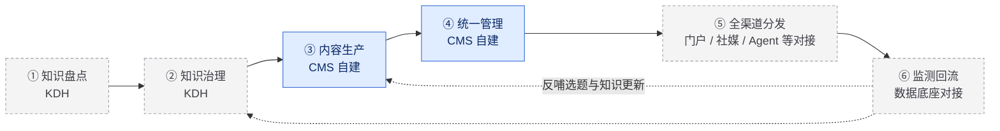

两条总原则（KA 方案 2.3）：
- **一条价值链**：环环相扣，CMS 不重复建设上下游已有的能力，但要把上下游需要的数据准备好、接口交付好。
- **一份事实源**：CMS 内容里的关键数值只引用 KDH 授权事实；知识更新能联动内容更新。

### 1.4 产品目标与成功标准

| 维度 | 标准 |
|---|---|
| KA 出口条件（2027 年 6 月末） | 样板客户中内容统一管理实际运行：AI 生产 → 多级审批 → 多渠道分发；CMS 企业版能力一次部署 |
| 一份事实源 | 对外内容中的关键数值 100% 可追溯到事实库中的事实；事实变更后，受影响内容 100% 自动刷新或生成复核任务 |
| 统一审批 | 所有对外发布动作（内容、事实回写、批次、上架）100% 经过审批中心；红线字段 100% 人工确认 |
| 统一出口 | 所有对外取用经过内容市场：只下发已生效版本，越界请求 100% 拦截并留痕 |
| 闭环 | 效果数据按内容 + 版本回传，可以据此生成选题 |

---

## 2. 产品范围

### 2.1 定位

**内容 CMS 只做“内容生产与统一管理”。** 知识治理、页面渲染、渠道运营、归因计算、账号网关都对接别的平台。CMS 负责的是：用可信的引用源生产内容，统一审批后，从内容市场这一个出口交给各方。

### 2.2 做什么、不做什么

| 领域 | 做（CMS 自建） | 不做（对接其他平台） |
|---|---|---|
| 生产 | 选题（含入口规则）、AI 生成、一稿多用、翻译、编辑器 AI、生产规范（模板 / Brand Voice / 术语库） | 视频剪辑、配音、播客等专业生产工具（外部 AI 工具，经 MCP 调用） |
| 管理 | 自产内容、编辑器、语种版本、变体与访问级别、数据表、内容模型 | 页面渲染、站点托管、域名、CDN、主题模板、个性化运行时分流（AI 门户） |
| 引用源 | 事实库与冲突处理；外部内容（引用 / 纳管）；资产库（副本、授权、AI 理解） | 知识盘点与治理（KDH）；专业 DAM 能力：深度打标、转码、去重（外部 DAM） |
| 审批与发布 | 审批中心（四类事项一套审批）、审批流程配置、发布检查、红线确认、发布批次 | 标准化审批产品本身（飞书 / 钉钉 / 企业微信 / 泛微 OA，可选对接） |
| 出口 | 内容市场：渠道标签、内容集合、对接方取用范围、取用记录、市场接口（API / MCP 只读 / Webhook） | 渠道运营（社媒发布、KDH 导入、产品平台展示由对接方自己完成）；SEO / GEO / SDR Agent 本身 |
| 回流 | 效果回流的展示与选题联动 | 埋点采集、归因计算、多域报表明细（统一数据底座） |
| 底座 | 组织与范围、成员与角色、规则、AI 与模型、审计日志 | 统一账号、权益计量、API / MCP 网关、凭证签发、模型网关（业务平台基础设施） |

### 2.3 核心原则

1. **一份事实源**：关键数值以“事实标签”写进内容，指向事实库；版本保存事实快照。
2. **三类引用源，三种接入方式**：
   - 引用源按用途分：数值进**事实库**；要读正文作引用的进**外部内容**；要原样给出去的文件进**资产库**；
   - 每类按对象选择接入方式：**全量导入**（先入库再用）、**用到才存**（被引用的那一刻才入库）、**仅链接**（只存引用记录）。
3. **冲突在用的时候处理，但不挡生产**：引用时发现冲突，作者选一个取值继续生成；审批通过即视为裁定，结果进入事实库并回写 KDH。
4. **一套审批**：所有“对外生效”的动作都在审批中心审批；审批引擎可替换，页面与状态不变。
5. **一个出口**：内容生效后进入内容市场，对接方按渠道标签或内容集合取用，CMS 不直接往各渠道“推发布”。
6. **人工把关**：AI 生成的内容要标识并逐段确认；红线字段（价格、折扣、交期、承诺）必须人工确认，Agent 不能推进。

### 2.4 用户与角色

| 角色 | 职责 | 默认范围 |
|---|---|---|
| 平台管理员 | 全部模块的查看与操作（原型默认角色）；负责内容模型、对接配置、审批流程、规则 | 全部 |
| 集团内容负责人 | 跨品牌查看、模板与规范、规则、审批 | 全部 |
| 品牌管理员 | 本品牌的内容、资产、Brand Voice、审批、内容市场 | 本品牌 |
| 内容编辑 | 选题执行、生成、编辑、送审 | 所在单元，可细到站点 / 语种 |
| 事实负责人 | 维护事实、处理冲突、确认事实发布、发起 KDH 补录 | 负责的产品线 |
| 合规审核 | 审批、复核、紧急放行；可查看全部事实 | 全部 |

外部协作者（翻译、代理商）通过邀请进入，范围限定、30 天后失效。经销商、渠道运营方不进后台，作为内容市场的对接方取用内容。

---

## 3. 产品架构

### 3.1 系统架构

CMS 内部分四层：引用源（来料）→ 生产 → 管理与审批 → 内容市场（出口）。上游平台经“上游接入”进入引用源，下游各方经“内容市场”取用。

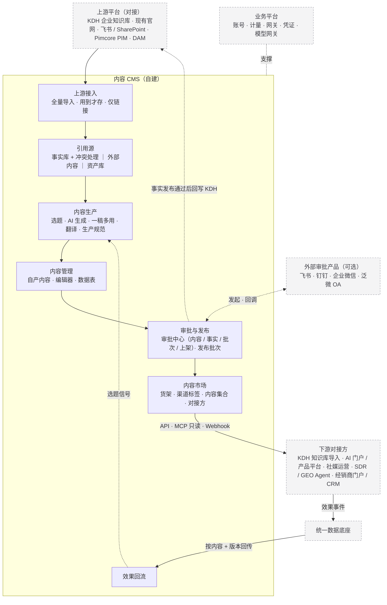

### 3.2 功能架构

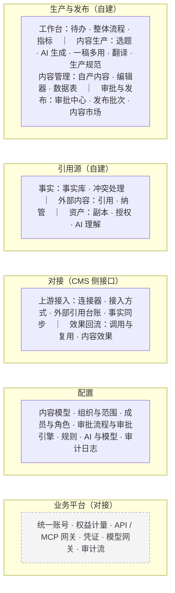

### 3.3 信息架构（菜单）

侧边栏分四区，共 25 个页面（编辑器与新建内容共用一页）。

```
── 生产与发布 · 自建 ──
工作台 ............................................ #/
内容生产   选题 ...................................... #/production/topics
           AI 生成 ................................... #/production/generate
           一稿多用 .................................. #/production/repurpose
           翻译任务 .................................. #/production/translations
           生产规范（模板 / Brand Voice / 术语库）...... #/production/standards
内容管理   自产内容 .................................. #/content
             └ 编辑器 / 新建内容 ...................... #/content/edit/:id  #/content/edit/new
           数据表 .................................... #/content/tables
审批与发布 审批中心 .................................. #/review
           发布批次 .................................. #/content/releases
           内容市场（货架 / 内容集合 / 对接方 / 取用记录） #/market
── 引用源 · 自建 ──
事实       事实库 .................................... #/facts
           冲突处理 .................................. #/facts/conflicts
外部内容 .......................................... #/external
资产 .............................................. #/assets
── 对接 · 其他平台 ──
对接       上游接入 .................................. #/integrations
           效果回流 .................................. #/insights/usage
── 配置 ──
设置       内容模型 · 组织与范围 · 成员与角色 · 审批流程
           · 规则 · AI 与模型 · 审计日志 ............... #/settings/*
```

每个页面顶部有统一的位置条：左边是面包屑（属于自建还是对接、在哪个菜单下），右边是当前页在主流程或事实流程中的步骤，可以点击跳转。

### 3.4 核心对象与关系

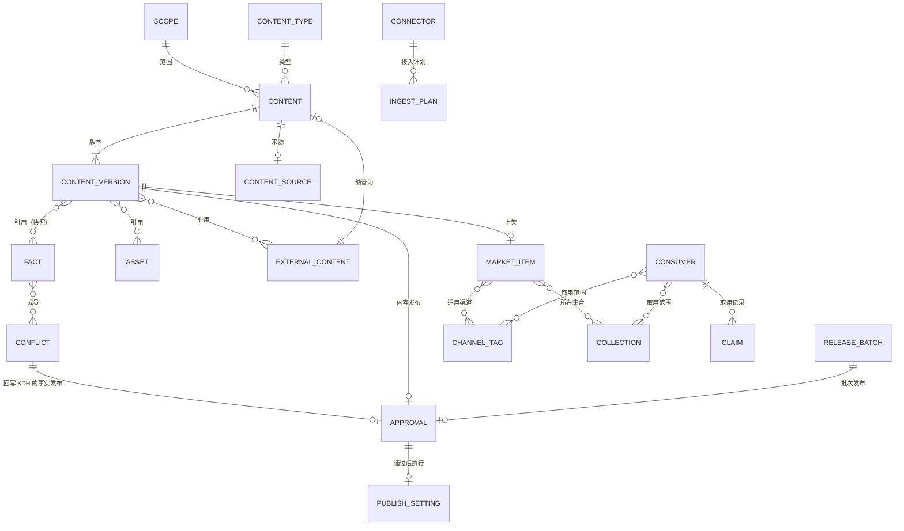

| 分组 | 对象 | 关键字段 |
|---|---|---|
| 范围 | 组织单元、区域、语种、站点、渠道 | 组织单元为树形；站点含域名、语种、hreflang 组；与 KDH 共用同一套划分 |
| 内容 | 内容类型 | 字段、组件、多语种字段、事实插槽、输出格式映射 |
| | 内容 | 类型、范围、负责人、状态、**来源**（AI 生成 / 一稿多用 / 翻译 / 人工新建 / 外部纳管，及选题、模板、源内容、引用） |
| | 内容版本 | 字段值、**事实快照**、**生成依据**、生成时的冲突取值、发布检查结果、AI 标识 |
| | 语种版本、内容变体 | 语种、站点页面地址；受众规则、实验分组、访问级别、令牌 |
| | 数据表 | 主键、列定义（可绑定事实）、行 |
| 引用源 | 事实 | 取值、证据等级、有效期、适用范围、可见级别、状态、同步状态、来源追踪 |
| | 冲突 | 类型、发现方式（同步时 / 使用中）、成员、推荐值与理由、裁定结果、回写审批单 |
| | 外部内容 | 来源系统、外部 ID、接入方式、源状态、被引用、已纳管为 |
| | 资产 | 文件、多语种标题与 alt、标签、授权、存储方式（本地 / 副本 / 仅链接）、来源追踪 |
| 审批 | 审批单 | 事项类型（内容发布 / 事实发布 / 批次发布 / 上架与推送）、对象、审批链、进度、**通过后执行的动作**（如发布设置） |
| | 审批流程 | 事项类型、范围、条件、节点、优先级、是否红线、能否紧急放行 |
| 发布 | 发布设置 | 上架渠道、加入的内容集合、命中的智能集合 |
| | 发布批次 | 条目（上线 / 下线 / 更新版本）、执行时间与时区、审批单 |
| 出口 | 市场条目 | 内容版本、适用渠道、所在集合、可取格式、取用数 |
| | 内容集合 | 类型（渠道内容包 / 专题集合 / 智能集合）、规则 |
| | 对接方 | 取用方式（订阅导入 / 按 ID 引用 / 取用副本）、取用范围（渠道 + 集合）、接入方式（API / MCP 只读 / Webhook） |
| | 取用记录 | 对接方、渠道、取用版本、最新版本 |
| 对接 | 连接器、接入计划、同步任务、外部引用台账、效果记录 | |
| 系统 | 用户、角色、审计日志 | |

### 3.5 状态

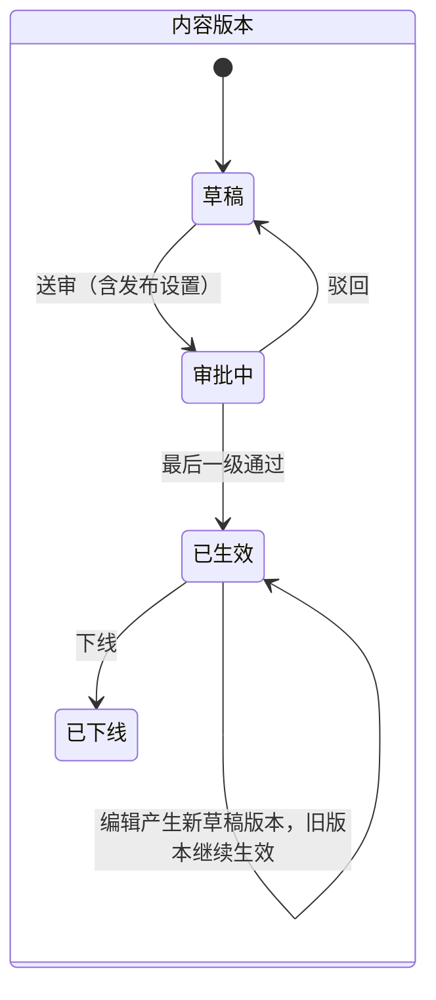

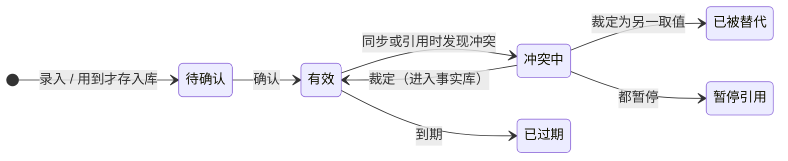

- **事实同步状态**：已同步 · 本地已修改（裁定后、回写审批通过前）· 源已更新 · 双方都改了 · 源已删除 · 同步失败。
- **审批单**：审批中 → 已通过（自动执行）/ 已驳回（不执行）。
- **市场条目渠道**：已上架 · 待审批（新增渠道）· 已下架。
- **集合成员**：已上架 · 审批中、通过后加入。

---

## 4. 业务流程

### 4.1 总览：三条线

CMS 的业务可以归为三条线：内容主线（蓝）、事实线（绿）、审批线（橙）。审批中心是另外两条线共用的关口：所有“对外生效”的动作都经过它。

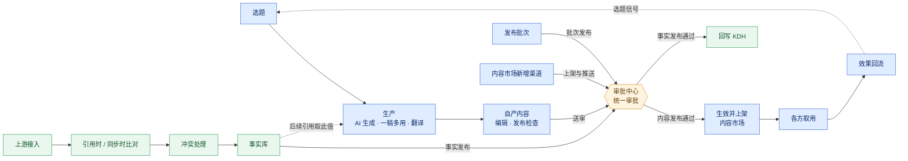

以下按业务分别展开。

### 4.2 内容主流程（端到端）

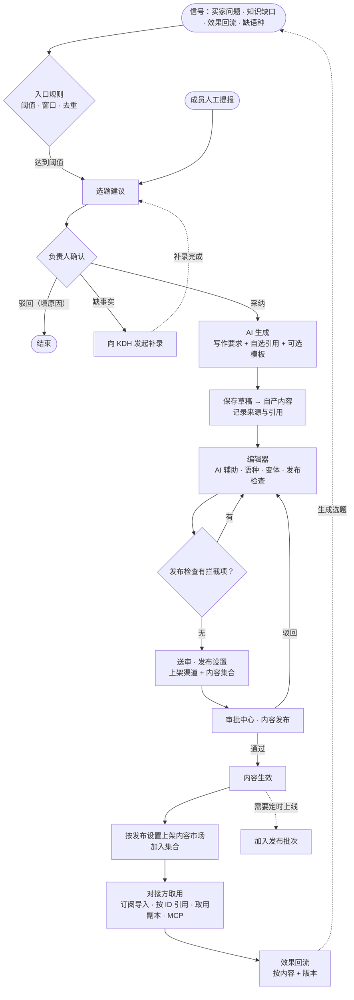

要点：
- 生产环节的三种方式（AI 生成、一稿多用、翻译）产出的都是自产内容草稿，走同一套检查、审批和发布。
- 渠道和集合在**送审时**一次定好，审批人一起看到；通过后自动执行，不需要再在别处“发布一次”。

### 4.3 选题流程

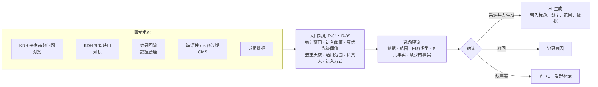

规则：
- 入口规则可配置：统计窗口、进入阈值、高优先级阈值、去重天数、适用范围、负责人规则、进入方式（需确认 / 自动进入）、启停；保存后按新规则重新计算建议。
- 缺少事实的选题不让 AI 编写数值，而是向 KDH 发起补录。

### 4.4 AI 生成与使用时冲突

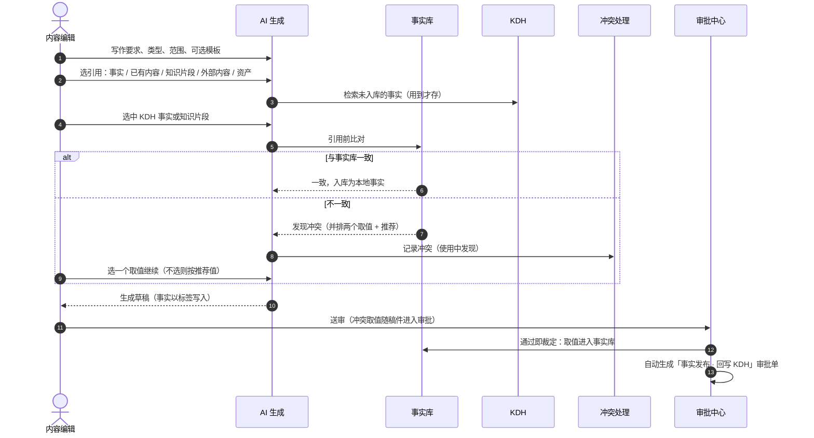

规则：
- 冲突**不阻止生成**：作者选一个取值即可继续；编辑器发布检查对它只做提醒，不拦截送审。
- 内容审批通过等于确认作者的取值：冲突按该取值裁定，进入事实库；同时生成回写 KDH 的事实发布申请。审批人不同意，可以驳回，或先到冲突处理改判。
- 已裁定的取值，后续生成直接使用；KDH 中对应条目显示“已入库为 F-xxx”。

### 4.5 一稿多用与翻译

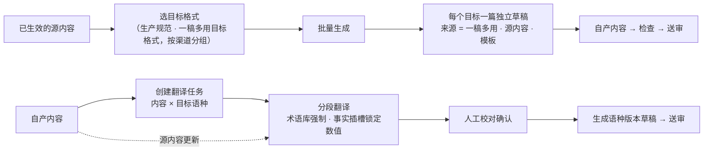

规则：
- 目标稿只能使用源内容引用的事实，不重新编造；红线字段与事实不一致时检查不通过。
- 目标格式模板在“生产规范”里按渠道分组维护（官网与 AI 搜索、社媒、销售、知识库）。
- 翻译：术语库强制使用；源内容更新后译文标为“源已更新”。

### 4.6 外部内容：接入、引用、纳管

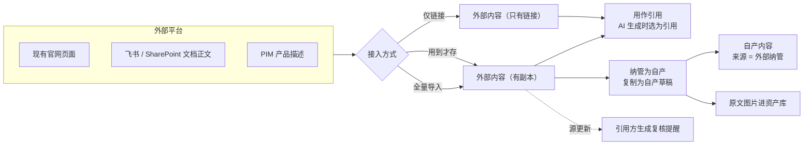

规则：
- 外部内容不经 CMS 审批和发布，也不出现在内容市场；只能被引用或纳管。
- 纳管后以 CMS 为准，外部原文只作来源记录；“仅链接”的内容没有副本，不能纳管。
- 源已删除的外部内容不能再引用；已引用的内容保留快照，并提醒复核。
- 文件类（图片、视频、PDF）不进外部内容，进资产库。

### 4.7 事实流程

#### 4.7.1 接入、冲突、入库、回写

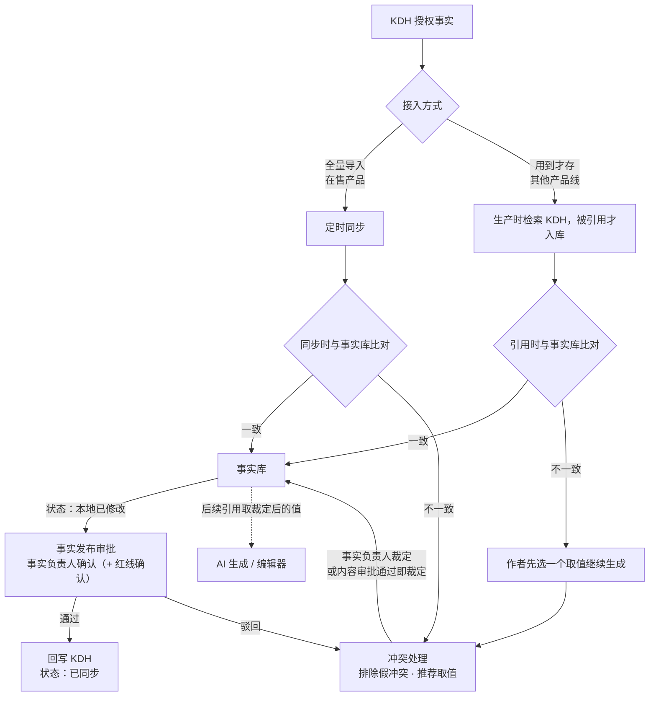

#### 4.7.2 KDH 事实变更对内容的影响

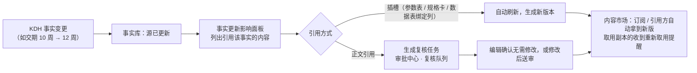

### 4.8 统一审批流程

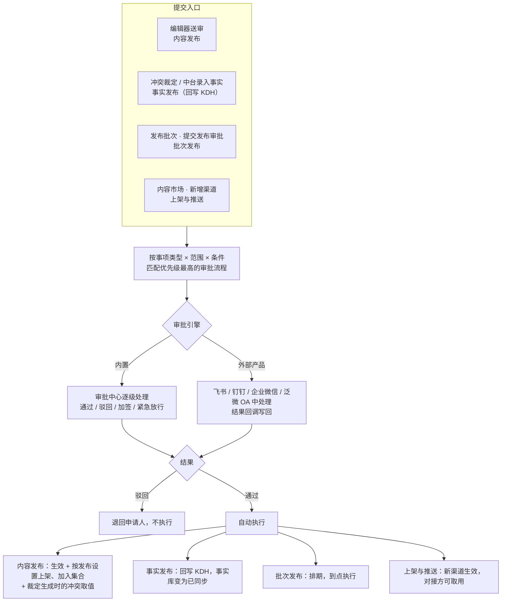

规则：
- 四类事项共用一个审批中心、一套审批流程配置；切换审批引擎后，页面和状态显示不变。
- 红线字段（价格、交期、承诺）所在的审批链增加“红线确认”节点，不能紧急放行，Agent 不能推进。
- 紧急放行：放行人须为集团内容负责人或合规审核，写原因，事后补审。
- 复核队列（事实变更、资产变更、过期引发的复核）和 Agent 建议也在审批中心处理；Agent 建议采纳后生成草稿，照常走检查和审批。

### 4.9 发布批次

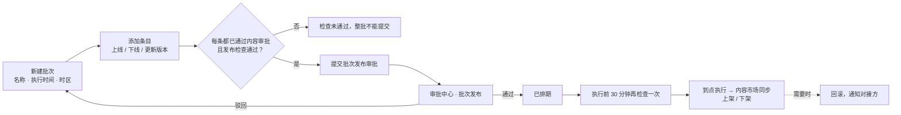

### 4.10 内容市场：上架、集合与取用

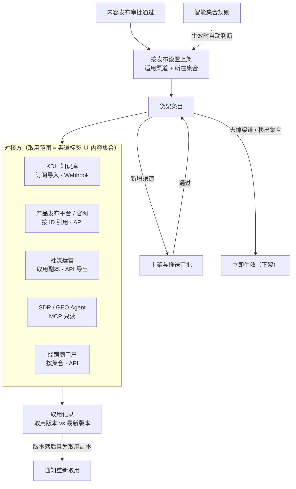

规则：
- 只下发已生效版本；服务端按对接方的取用范围过滤，越界请求返回 403 并留痕。
- 三种取用方式的更新行为：订阅导入 → 自动推送新版；按 ID 引用 → 实时取最新版；取用副本 → 提醒重新取用。
- 凭证、网关、计量由业务平台基础设施提供，内容市场只定义“谁能取哪些内容、怎么取”。

### 4.11 资产入库与授权

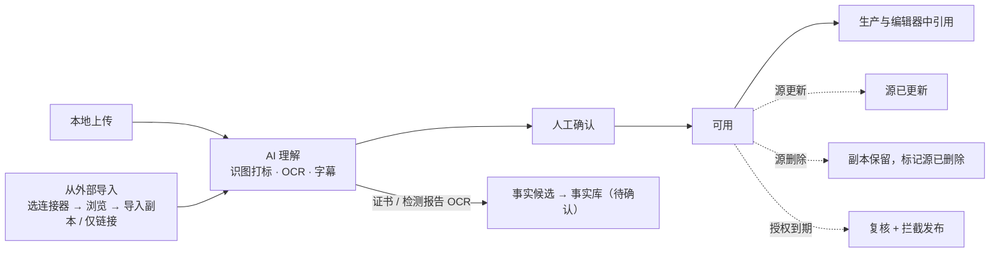

### 4.12 效果回流

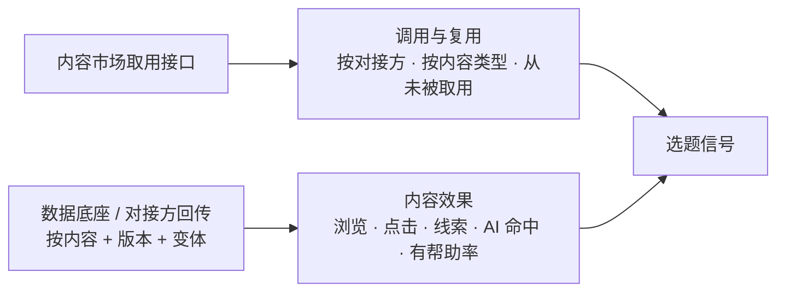

CMS 不采集前端埋点，不做归因计算。

---

## 5. 功能清单

按菜单列出。“说明”一栏写功能要点和关键规则；详细业务规则见第 6 章。

### 5.1 工作台

| 页面 | 功能 | 说明 |
|---|---|---|
| 工作台 `#/` | 整体流程 | 内容主线、事实、审批三条线，每一步可点击进入对应页面 |
| | 关键指标 | 待我处理、审批中 / 待复核、未处理冲突、近 7 天调用 |
| | 我的待办 | 冲突、待审、复核、同步异常、授权到期；按类型切换，按优先级与期限排序 |
| | 内容健康度摘要 | 过期事实、缺语种、缺摘要、资产失效、结构化标注不完整等问题数 |
| | 最近活动 | 成员、Agent、系统的最近操作 |

### 5.2 内容生产

| 页面 | 功能 | 说明 |
|---|---|---|
| 选题 `#/production/topics` | 选题建议 | 依据、范围、内容类型、可用事实、缺少的事实、优先级；待确认 / 已采纳 / 已驳回 |
| | 入口规则 | R-01 买家高频问题、R-02 知识缺口、R-03 效果下降、R-04 缺语种 / 过期、R-05 人工提报；可配窗口、阈值、高优先级、去重、范围、负责人、进入方式、启停 |
| | 采纳并去生成 | 带标题、类型、范围、依据进入 AI 生成 |
| | 提报选题 | 成员人工提报 |
| | KDH 补录 | 缺少的事实向 KDH 发起补录，不让 AI 编写 |
| AI 生成 `#/production/generate` | 写作要求 | 一句话要求 + 内容类型 + 范围（品牌 · 区域 · 语种） |
| | 可选模板 | 选了按模板结构写，并提示缺哪些必需事实；不选也能生成 |
| | 自选引用 | 事实（库内 + KDH 未入库）、已有内容、知识库片段、外部内容、资产；不可用的事实灰显并写明原因 |
| | 使用时冲突 | 引用 KDH 事实或片段时比对；冲突并排展示、给出推荐，选一个继续，不选按推荐值；冲突同步记入冲突处理 |
| | 预览与保存 | 生成预览；保存为自产内容草稿，记录来源（选题、模板、引用）与冲突取值 |
| 一稿多用 `#/production/repurpose` | 源内容 + 目标格式 | 源须为已生效版本；目标格式来自生产规范，按渠道分组 |
| | 批量生成 | 每个目标一篇独立草稿，来源标为一稿多用；可单个重新生成 |
| 翻译任务 `#/production/translations` | 批量创建 | 内容 × 目标语种；大模型 + 术语库 / 机器翻译 / 外部供应商 |
| | 分段校对 | 术语不符标红；事实插槽锁定数值；完成后生成语种版本草稿 |
| 生产规范 `#/production/standards` | 模板 | 生成模板（按内容类型，TPL-xx）和一稿多用目标格式（按渠道分组：官网与 AI 搜索 / 社媒 / 销售 / 知识库，RF-xx）；新建、启停 |
| | Brand Voice | 按品牌：语调、人设、禁用词、必用表述、正反示例；生成时套用、发布时检查 |
| | 术语库 | 多语种对照、不翻译标记、禁用变体；导入导出 |

### 5.3 内容管理

| 页面 | 功能 | 说明 |
|---|---|---|
| 自产内容 `#/content` | 列表 | 按类型分组；各语种版本状态；**来源**列（AI 生成 / 一稿多用 / 翻译 / 人工新建 / 外部纳管） |
| | 筛选 | 状态、来源、品牌、标记（待复核 / 检查未通过 / 含 AI） |
| | 批量操作 | 批量送审、批量下线、导出 |
| 编辑器 `#/content/edit/:id` | 编辑 | 字段表单 + 块编辑器（段落、参数表、图片、FAQ）；数值以事实标签插入，参数表为事实插槽 |
| | 检查面板 | 发布检查实时显示，每项给出处理入口；生成时的冲突取值显示为提醒 |
| | 事实 / 资产 / AI 面板 | 搜索并插入事实、资产；AI 改写、扩写、缩写、翻译、摘要、Brand Voice 检查，结果需采纳 |
| | 在编辑器内处理冲突 | 有权限可裁定（进入事实库 + 生成回写审批）；无权限可在本内容中移除引用 |
| | 送审 · 发布设置 | 选上架渠道（按类型预选）、加入内容集合；提示命中的智能集合 |
| | 变体与个性化 | 变体、受众规则、实验分组、访问级别、令牌；运行时由门户选择 |
| | 语种版本 | 各语种状态、站点与页面地址、翻译来源；输出 hreflang |
| | 引用与依据 | 来源卡片（生产方式、选题、模板、源内容）；引用的事实与引用方式；生成依据 |
| | 版本历史 / 调用情况 | 版本、变更说明、回滚；哪些对接方取过、取的哪个版本 |
| 数据表 `#/content/tables` | 表格编辑 | 产品目录、伙伴名录、资源库；新增行、搜索 |
| | 导入导出 | 导入先预检（与事实不一致、类型错误）；导入的行为草稿，送审后生效 |
| | 绑定事实的列 | 只读，跟随事实库自动刷新 |

### 5.4 审批与发布

| 页面 | 功能 | 说明 |
|---|---|---|
| 审批中心 `#/review` | 待审批 | 内容发布 / 事实发布 / 批次发布 / 上架与推送四类；按类型筛选；审批链进度 |
| | 内容发布详情 | 本次修改、发布检查、AI 段落确认、红线确认、**发布设置**、**生成时的冲突取值** |
| | 其他事项详情 | 申请发布什么（前后对比）、通过后执行什么、跳转到原对象 |
| | 处理 | 通过（转下一节点 / 通过并执行）、驳回（必填意见）、加签、紧急放行 |
| | 复核队列 | 事实变更、资产变更、过期引发的复核：确认无需修改或去修改 |
| | Agent 建议 | SEO / GEO / SDR Agent 经 MCP 提交的建议；采纳后生成草稿 |
| | 审核记录 | 通过、驳回、紧急放行的记录 |
| 发布批次 `#/content/releases` | 编排 | 条目（上线 / 下线 / 更新版本）、执行时间与时区 |
| | 提交发布审批 | 全部条目就绪才能提交；状态：编排中 → 发布审批中 → 已排期 → 已执行 / 已回滚 |
| | 重新检查 / 回滚 | 执行前 30 分钟自动再检查；回滚后通知对接方 |
| 内容市场 `#/market` | 货架 | 已生效内容；适用渠道 + 所在集合；可取格式；可被谁取用；取用数与落后份数；按渠道筛选、搜索 |
| | 标签与取用 | 调整渠道（AI 建议渠道）；新增渠道走上架审批，去掉渠道立即下架；推送给订阅方 |
| | 内容集合 | 渠道内容包 / 专题集合 / 智能集合；集合内容（已上架、审批中待加入）；取用该集合的对接方；新建集合、移出内容 |
| | 对接方与接口 | 对接方的取用方式、取用范围（渠道 + 集合）、接入方式（API / MCP 只读 / Webhook）；新增对接方；市场接口说明 |
| | 取用记录 | 取用版本与最新版本对比；版本落后时通知重新取用 |

### 5.5 引用源

| 页面 | 功能 | 说明 |
|---|---|---|
| 事实库 `#/facts` | 生命周期说明 | 怎么来（全量导入 / 用到才存）、怎么用（引用与插槽）、怎么更新（同步与冲突） |
| | 列表与详情 | 对象树；取值、证据、有效期、适用范围、可见级别、状态、同步状态、被引用数；详情含取值与范围、被引用、同步、变更历史 |
| | 事实更新影响 | KDH 变更涉及的内容：插槽自动刷新、正文生成复核 |
| | 录入事实 | 先做冲突预检；录入后经事实发布审批同步到 KDH |
| | 属性定义 | 来自 KDH，只读 |
| 冲突处理 `#/facts/conflicts` | 冲突队列 | 同步时发现、使用中发现两种来源；五类冲突 |
| | 处理面板 | 两条取值并排、推荐值与命中规则、假冲突提示、受影响内容 |
| | 裁定 | 采纳 / 拆分适用范围 / 都暂停 / 发起源系统修正；依据必填；结果立即进入事实库，并生成回写 KDH 的事实发布审批，显示回写进度 |
| 外部内容 `#/external` | 列表 | 来源系统、接入方式、源状态、被哪些自产内容引用、是否已纳管；按来源系统、接入方式筛选 |
| | 用作引用 | 进入 AI 生成，自动选为引用（外部内容页签） |
| | 纳管为自产 | 复制为自产草稿（来源 = 外部纳管），原文图片进资产库；仅链接的不能纳管 |
| | 重新同步 | 源已更新时从源重新同步，并提醒引用方复核 |
| 资产 `#/assets` | 资产库 | 网格浏览、筛选、自然语言搜索（显示命中原因） |
| | 资产详情 | 预览、AI 理解、内容侧字段（多语种标题 / alt）、授权、被引用、来源与同步 |
| | AI 处理队列 | OCR、识图打标、视频字幕 / 摘要；结果待人工确认；证书 OCR → 事实候选 |
| | 待处理 | 源已更新、源已删除、授权到期、待审 |
| | 上传 / 从外部导入 | 选连接器 → 浏览 → 导入副本或仅链接 |

### 5.6 对接

| 页面 | 功能 | 说明 |
|---|---|---|
| 上游接入 `#/integrations` | 连接器 | KDH（双向）、MuseDAM、飞书、SharePoint、Pimcore、现有官网；状态、同步量、异常；立即同步、重新授权、新建 |
| | 接入方式 | 每个连接器按对象类型配置全量导入 / 用到才存 / 仅链接，以及范围与落点（事实库 / 外部内容 / 资产库 / 引用快照） |
| | 外部引用台账 | 每条外部数据存在哪、被谁引用、源状态 |
| | 同步任务 / 同步异常 | 批次与结果；鉴权过期、映射错误、拉取失败、双方都改了 |
| | 事实同步规则 | 按属性类别设置同步方向，红线类别人工确认 |
| 效果回流 `#/insights/usage` | 调用与复用 | 总调用、被取用内容数、复用率、越界数；按对接方、按内容类型；从未被取用的内容 |
| | 内容效果 | 按内容 + 版本：浏览、点击率、线索、AI 回答命中、有帮助率；据此生成选题 |

### 5.7 设置

| 页面 | 功能 | 说明 |
|---|---|---|
| 内容模型 `#/settings/models` | 内容类型、组件、字段 | 字段类型含事实插槽、变体、资产引用；AI 一句话生成草案；保存前预览影响 |
| 组织与范围 `#/settings/org` | 范围划分 | 品牌 / 事业部层级、区域、语种（回退语种、人工校对）、站点（域名、hreflang 组）、渠道 |
| 成员与角色 `#/settings/members` | 成员 = 角色 × 范围 | 账号来自平台统一账号；权限矩阵；邀请外部协作者；自定义角色 |
| 审批流程 `#/settings/approvals` | 审批引擎 | 内置（默认）/ 飞书 / 钉钉 / 企业微信 / 泛微 OA / 自定义接口；外部引擎配置发起、回调、映射 |
| | 审批流程 | AF-01 对外内容 · 标准、AF-02 欧盟 · 加法务、AF-03 事实发布 · 红线字段、AF-04 事实发布 · 回写 KDH、AF-05 批次发布、AF-06 上架与推送；按事项类型筛选；节点、条件、时限、优先级、紧急放行；模拟匹配 |
| 规则 `#/settings/rules` | 三类规则 | 发布检查规则（拦截 / 提醒、阈值、启停）；冲突选择规则（推荐顺序、假冲突维度）；事实同步方向 |
| AI 与模型 `#/settings/ai` | AI 能力 | 每项能力选模型、开关，标明数据是否出内网；生成类结果必须人工确认 |
| | 用量 / 外部工具 | 本月用量与额度；外部 MCP 工具（视频剪辑、配音等）登记与启停 |
| 审计日志 `#/settings/audit` | 日志 | 成员、AI、同步、MCP 对接方的操作；红线 / 敏感级别；修改前后；导出 |
| | 按事实追溯 | 从一条事实追到冲突、内容、审批、批次、取用 |

---

## 6. 关键业务规则

### 6.1 接入方式与落点

| 接入方式 | 什么时候入库 | 冲突何时发现 | 适用 |
|---|---|---|---|
| 全量导入 | 按范围定时同步，先入库再使用 | 同步时 | 在售产品的事实、现有官网页面、PIM 描述、素材文件夹 |
| 用到才存 | 生产时检索源系统，被引用的那一刻入库 | 引用时 | 其他产品线的事实、KDH 知识片段、DAM 资产、飞书定稿文档 |
| 仅链接 | 不入库，只存引用记录 | — | 客户要求文件不出库的网盘内容 |

| 落点 | 放什么 |
|---|---|
| 事实库 | 结构化数值（规格、认证、交期、价格等） |
| 外部内容 | 要读正文作引用的文字（网页、文档正文、产品描述） |
| 资产库 | 原样给出去的文件（图片、视频、PDF） |
| 内容版本的引用快照 | KDH 知识片段原文与出处 |

三条线：
1. **副本不等于授权**：授权到期或源系统撤回时，有副本也要拦截发布。
2. **副本会变旧**：源更新时标为“源已更新”，事实类差异进入复核，不能默默用旧值。
3. **源删除不等于本地删除**：副本保留并标记，已发布内容不受影响，新引用需要确认。

### 6.2 冲突

| 类型 | 例子 | 何时检测 |
|---|---|---|
| ① 事实 vs 事实 | 防护等级 IP66（检测报告）/ IP65（旧手册） | 全量同步时；用到才存的在引用时 |
| ② 内容 vs 事实 | 正文写 1000 N·m，事实为 1200 N·m | 保存草稿、送审 |
| ③ 内容 vs 内容 | 两篇已生效内容的交付周期不同 | 定期巡检 |
| ④ 时效 | 证书过期仍被引用 | 每日 |
| ⑤ 同步冲突 | 中台改为 8 周、KDH 改为 12 周 | 每次同步 |

- **先排除假冲突**：型号 / 配置、区域、测试标准、生效时间任一维度能区分开的，提示拆分适用范围。
- **推荐顺序**（可配置）：权威来源 → 证据等级 → 生效时间 → 人工判断。
- **处理动作**：采纳一条（另一条已被替代）/ 拆分适用范围 / 都暂停引用 / 发起源系统修正。
- **裁定生效**：立即进入事实库，后续引用取此值；回写 KDH 需事实发布审批。
- **生成时的冲突**：不阻止生成，作者选值继续；内容审批通过即裁定。

### 6.3 内容引用事实

- 编辑器插入的是带事实 ID 的事实标签，渲染时取当前值；每个版本保存引用事实的取值快照。
- **插槽引用**（参数表、规格卡、数据表绑定列）：事实更新后自动刷新并生成新版本。
- **正文引用**：事实更新后不自动改写，生成复核任务。
- 对外内容只能引用：证据 A / B + 可见级别“公开” + 有效 + 无未处理冲突（生成时已选值的冲突除外，由审批确认）。

### 6.4 发布检查

| 检查项 | 默认级别 |
|---|---|
| 对外内容的事实证据等级（A / B） | 拦截 |
| 引用了过期事实（提前 30 天提醒） | 拦截 |
| 存在未处理冲突 | 拦截 |
| 生成时选用的冲突取值（待审批确认） | 提醒 |
| 事实可见级别非“公开” | 拦截 |
| 资产授权到期或不覆盖发布区域 / 渠道 | 拦截 |
| Brand Voice 禁用词、广告法绝对化用语 | 拦截 |
| AI 生成段落未确认 | 拦截 |
| 缺 AI 摘要 / 结构化标注 | 提醒 |
| 区域必需语种不齐 | 提醒（可改为拦截） |

拦截项未通过不能送审，审批人也不能绕过。

### 6.5 审批与红线

| 事项 | 提交入口 | 默认流程 | 通过后自动执行 |
|---|---|---|---|
| 内容发布 | 编辑器送审 | AF-01 / AF-02 | 内容生效；按发布设置上架、加入集合；裁定生成时的冲突取值 |
| 事实发布 | 冲突裁定、中台录入的事实 | AF-04，红线字段命中 AF-03 | 回写 KDH，事实库显示已同步 |
| 批次发布 | 发布批次“提交发布审批” | AF-05 | 排期，到点执行 |
| 上架与推送 | 内容市场新增渠道 | AF-06 | 新渠道生效，对接方可取用 |

- 匹配规则：事项类型 × 范围 × 条件，取优先级最高的流程。
- 红线字段（价格、折扣、交期、承诺）：对所有角色只读，修改走红线审批；Agent 不能推进；不能紧急放行。
- 下架类动作（去掉渠道、移出集合、批量下线）立即生效，不需要审批，留审计记录。

### 6.6 内容市场取用

| 取用方式 | 典型对接方 | 接入 | 内容更新后 |
|---|---|---|---|
| 订阅导入 | KDH 知识库、CRM | Webhook 推送 | 自动推送新版 |
| 按 ID 引用 | 产品发布平台、官网、经销商门户 | API | 实时取最新生效版本 |
| 取用副本 | 社媒运营 | API 按渠道导出 | 提醒重新取用 |
| Agent 检索 | SDR / GEO Agent | MCP 只读 | 实时 |

- 取用范围 = 渠道标签 ∪ 内容集合；只返回范围内的已生效版本；越界返回 403 并留痕。
- MCP 分级：只读（检索、读取已生效内容）对外开放；写入（创建草稿、提交建议）结果进入审批中心；高风险（发布、下线、删除）默认关闭。

### 6.7 权限矩阵

● 完整操作　◐ 本范围内操作　○ 只读　— 不可见。平台管理员拥有全部权限，原型默认以平台管理员进入。

| 模块 | 平台管理员 | 集团负责人 | 品牌管理员 | 内容编辑 | 事实负责人 | 合规审核 |
|---|---|---|---|---|---|---|
| 工作台 | ● | ● | ● | ● | ● | ● |
| 内容生产 | ● | ● | ◐ | ◐ | — | — |
| 生产规范 | ● | ● | ◐ | ○ | — | ○ |
| 内容管理 | ● | ● | ◐ | ◐ | ○ | ○ |
| 审批中心 | ● | ● | ◐ | — | ◐（仅事实发布） | ● |
| 内容市场 | ● | ● | ◐ | ○ | ○ | ○ |
| 事实库 | ● | ○ | ○ | ○ | ◐ | ○ |
| 冲突处理 | ● | ○ | ○ | — | ◐ | ○ |
| 外部内容 · 资产 | ● | ● | ◐ | ◐ | ○ | ○ |
| 上游接入 | ● | ○ | — | — | ○ | — |
| 效果回流 | ● | ● | ◐ | — | — | ○ |
| 设置（含审计日志） | ● | ○ | — | — | — | — |
| 规则 | ● | ● | — | — | — | — |

事实负责人在审批中心只看到并处理“事实发布（回写 KDH）”类审批单。

---

## 7. 对接接口清单

| 对接对象 | 方向 | 接口与事件 | CMS 侧页面 |
|---|---|---|---|
| KDH | 双向 | 事实读取、检索（用到才存）、变更事件、属性定义与可见级别（只读）、补录请求；事实发布审批通过后回写 | 上游接入、事实库、冲突处理、AI 生成、选题 |
| KDH（作为对接方） | 下发 | 内容市场 Webhook `market.item.*` → KDH 导入 | 内容市场 |
| 现有官网、飞书、SharePoint、PIM | 拉取 | 鉴权、浏览与搜索、正文 / 文件、变更通知 | 上游接入、外部内容、资产 |
| DAM | 拉取 | 鉴权、浏览、元数据、渲染地址、变更通知 | 上游接入、资产 |
| AI 门户、产品平台、经销商门户 | 下发 | `GET /api/v1/market/items`、`/items/{id}`、`/collections/{id}/items`；Preview API | 内容市场 |
| 社媒运营 | 下发 | `GET /api/v1/market/items/{id}/export?channel=` | 内容市场 |
| SDR / GEO Agent | 下发 + 写回 | MCP `market.search` / `market.get`（只读）；建议提交（写入，进审批中心） | 内容市场、审批中心 |
| 外部审批产品 | 双向 | 发起审批、结果回调、字段映射 | 审批流程、审批中心 |
| 统一数据底座 | 回传 | 效果事件（内容 + 版本 + 变体） | 效果回流 |
| 业务平台 | 支撑 | 统一账号、凭证签发、计量、网关、模型网关、审计流 | 成员与角色、内容市场、AI 与模型、审计日志 |
| 外部 AI 工具 | 调用 | MCP 客户端（视频剪辑、配音、播客） | AI 与模型 |

---

## 8. 非功能需求

| 项 | 要求（建议值，待评审） |
|---|---|
| 市场接口延迟 | 有缓存 P95 < 100ms；无缓存 P95 < 300ms |
| 单租户规模 | 内容 100 万个版本、资产 50 万、事实 10 万 |
| 可用性 | SaaS 99.9%；KA 对标的 99.99% 由门户与 CDN 承担 |
| 审计 | 所有写操作和对外取用 100% 留痕，保留 3 年 |
| 安全 | 多租户隔离；MCP 提示注入防护；高风险工具人工确认 |
| 部署 | 公有云 SaaS / 混合 / 全私有化，同一代码基线 |
| 信创 | x86 / ARM；兼容麒麟、统信、达梦、人大金仓；第二阶段不承诺全栈认证 |
| 国际化 | 界面中英文；内容多语种，含回退语种 |
| 响应式 | 桌面优先；平板与手机宽度可用 |

---

## 9. 待决策

| # | 问题 | 现状 |
|---|---|---|
| 1 | 各类对象的默认接入方式（哪些全量、哪些用到才存）由谁定、按什么标准 | 原型按“在售产品全量、其他用到才存、不出库的仅链接”演示 |
| 2 | 生成时选用的冲突取值，由内容审批“顺带裁定”是否合适；是否需要事实负责人会签 | 原型按“内容审批通过即裁定，再走事实发布审批回写 KDH”演示 |
| 3 | 审批引擎对接外部产品的范围：只同步结果，还是节点也在外部配置 | 原型只做界面示意 |
| 4 | 内容市场与业务平台网关的分工：凭证、限流、计量的接口口径 | 需与平台组确认 |
| 5 | 外部内容纳管后，是否保持与源的同步（例如官网旧页面继续更新） | 原型按“纳管后以 CMS 为准，原文只作来源”演示 |
| 6 | 插槽自动刷新后的新版本免审还是简审 | 原型按“免审、仅记录”演示 |
| 7 | 事实负责人是独立角色，还是由品牌管理员兼任 | 原型按独立角色演示 |
| 8 | 数据表是否保留在本期范围 | 调研中按 HubSpot HubDB 对标保留，可再评估 |
| 9 | 非功能指标是否认可 | 待评审 |

---

## 附录 A：原型页面清单

| # | 分区 | 菜单 | 页面 | 路由 |
|---|---|---|---|---|
| 1 | 生产与发布 | 工作台 | 工作台 | `#/` |
| 2 | | 内容生产 | 选题 | `#/production/topics` |
| 3 | | | AI 生成 | `#/production/generate` |
| 4 | | | 一稿多用 | `#/production/repurpose` |
| 5 | | | 翻译任务 | `#/production/translations` |
| 6 | | | 生产规范 | `#/production/standards` |
| 7 | | 内容管理 | 自产内容 | `#/content` |
| 8 | | | 编辑器 / 新建内容 | `#/content/edit/C-1002`、`#/content/edit/new` |
| 9 | | | 数据表 | `#/content/tables` |
| 10 | | 审批与发布 | 审批中心 | `#/review` |
| 11 | | | 发布批次 | `#/content/releases` |
| 12 | | | 内容市场 | `#/market` |
| 13 | 引用源 | 事实 | 事实库 | `#/facts` |
| 14 | | | 冲突处理 | `#/facts/conflicts` |
| 15 | | 外部内容 | 外部内容 | `#/external` |
| 16 | | 资产 | 资产 | `#/assets` |
| 17 | 对接 | 对接 | 上游接入 | `#/integrations` |
| 18 | | | 效果回流 | `#/insights/usage` |
| 19 | 配置 | 设置 | 内容模型 | `#/settings/models` |
| 20 | | | 组织与范围 | `#/settings/org` |
| 21 | | | 成员与角色 | `#/settings/members` |
| 22 | | | 审批流程 | `#/settings/approvals` |
| 23 | | | 规则 | `#/settings/rules` |
| 24 | | | AI 与模型 | `#/settings/ai` |
| 25 | | | 审计日志 | `#/settings/audit` |

## 附录 B：演示路径

| # | 演示什么 | 操作 |
|---|---|---|
| 1 | 整体结构 | 工作台“整体流程”三条线逐步点进 |
| 2 | 选题入口规则 | 选题 → 入口规则，把 R-01 阈值降到 30 → 出现 TP-42 → 采纳并去生成 |
| 3 | 使用时冲突不挡生成 | AI 生成 → 引用 KDH 事实“交期 10 周”→ 冲突面板选 10 周 → 生成并保存 |
| 4 | 冲突经审批进入事实库并回写 KDH | 送审 → 审批中心看冲突取值与发布设置 → 两级通过 → 事实库 F-007 = 10 周（本地已修改）→ 通过事实发布审批 → 已同步 |
| 5 | 发布设置与内容市场 | 编辑器送审时勾选“汉诺威工业展专题”→ 审批通过 → 内容市场货架与“内容集合”中出现 |
| 6 | 对接方取用范围 | 内容市场 → 对接方与接口：经销商门户按集合取用、Agent 经 MCP 只读 |
| 7 | 外部内容纳管 | 外部内容 → PIM 产品描述“纳管为自产”→ 打开自产草稿，来源显示外部纳管 |
| 8 | 统一审批 | 发布批次“提交发布审批”、内容市场新增渠道 → 审批中心按类型筛选 |

演示数据可在头像菜单“重置演示数据”。

## 附录 C：演示数据口径

| 维度 | 口径 |
|---|---|
| 品牌与产品 | 北岭智造：BL-R600 六轴工业机器人、BL-R800 新品、BL-R500 旧款、BL-D120 除尘设备；汉川传动：HC-RV200 减速机、HC-SD75 伺服驱动器 |
| 内容 | 已生效 214、审批中 5、草稿 18；类型：产品说明、技术 FAQ、客户案例、落地页、白皮书、销售资料、社媒短帖、公众号文章、销售话术卡 |
| 外部内容 | EX-204 汉川旧官网产品页（已纳管为 C-1004）、EX-211 BL-R600 官网页（源已更新）、EX-305 飞书新闻稿、EX-318 SharePoint 渠道政策、EX-402 PIM 产品描述、EX-509 已删除的旧页面 |
| 内容集合 | COL-12 经销商季度内容包、COL-11 汉诺威工业展专题、COL-10 SDR 知识集 · 欧盟（智能）、COL-09 东南亚新品上市包 |
| 对接方 | KDH 知识库、产品发布平台、社媒运营、欧盟官网、CRM 销售助手、Nordwerk 经销商门户、SDR / GEO Agent |
| 审批单 | RV-551～554 内容发布、AP-601 事实发布、AP-602 批次发布、AP-603 上架与推送 |
| 冲突 | CF-018 防护等级（待处理）；生成时发现的冲突从 CF-031 起编号 |
| 角色 | 陈立（集团负责人）、周敏（品牌管理员）、林悦（内容编辑）、王拓（事实负责人）、何静（合规审核）、孙铭（平台管理员） |
