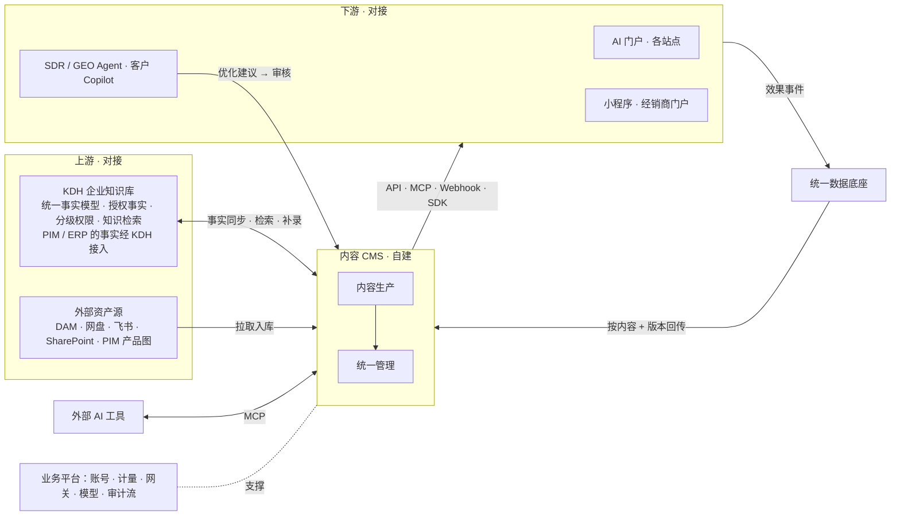

# 内容 CMS · 产品需求文档（PRD v1，2026-11-20）

| 项 | 内容 |
|---|---|
| 产品 | 内容 CMS（原型中称“内容中台”），内容中心企业版的内容管理部分 |
| 关联文档 | 《01-调研报告》：背景、HubSpot 对标、厂商调研 |
| 原型 | `prototype/`，共 28 页（React + Tailwind + shadcn/ui），运行方式见 `prototype/README.md` |
| 读法 | 每个功能都标了原型路由 `#/xxx`，可以直接打开对照 |

---

## 1. 产品概述

### 1.1 定位

**内容 CMS 只做价值链里的“生产与统一管理”两环，其他环节对接别的平台。**

```
知识源 → KDH 治理 → 【CMS 生产 → CMS 统一管理】 → 全渠道分发 → 效果回流
          对接              自建        自建            对接          对接
```

### 1.2 做什么、不做什么

| 做（自建） | 不做（对接） |
|---|---|
| 选题、模板生成、一稿多用、翻译、编辑器 AI、生产规范 | 知识盘点与治理（KDH） |
| 内容模型、内容库、数据表、内容集合、发布批次 | 页面渲染、站点托管、域名、CDN、反向代理、主题模板（AI 门户） |
| 语种版本与 hreflang、站点归属、内容变体与实验标识、访问级别、令牌 | 访客个性化与 A/B 的运行时分流（AI 门户） |
| 事实引用：KDH 授权事实的本地副本、录入端、冲突处理 | 归因计算与多域报表明细（统一数据底座） |
| 资产库：本地上传、导入副本、仅引用；AI 理解 | 专业 DAM 能力：深度打标、转码、去重（外部 DAM） |
| 审批、发布检查、红线确认、范围权限、审计、健康度 | SEO / GEO / SDR 等 Agent 本身（各 Agent 产品） |
| 对接层：上游接入、下游分发（API / MCP / Webhook / SDK）、效果回流 | 账号、计量、网关、模型网关、Agent 运行（业务平台） |
| 环境与模型迁移、自动化流程 | 视频剪辑、配音、播客（外部 AI 工具） |

**核心原则**：
1. **一份事实源**：内容中的关键数值只引用 KDH 授权事实。
2. **拉取入库**：从外部取到的数据存一份到 CMS 对应位置，外部链接失效也不影响使用。
3. **人工把关**：AI 生成的内容要标识并逐段确认；红线字段必须人工确认。
4. **对接清楚**：对接平台需要的数据由 CMS 准备好，通过接口交付。

### 1.3 目标用户与角色

| 角色 | 职责 | 默认范围 |
|---|---|---|
| 平台管理员 | 全部模块的查看与操作（原型默认角色）；负责内容模型、对接配置、调用方、规则、环境 | 全部 |
| 集团内容负责人 | 跨品牌查看、模板与规范、洞察、规则 | 全部 |
| 品牌管理员 | 本品牌的内容、资产、Brand Voice、审批 | 本品牌 |
| 内容编辑 | 选题执行、生成、编辑、送审 | 所在单元，可细到站点 / 语种 |
| 事实负责人 | 录入与维护事实、处理冲突、发起 KDH 补录 | 负责的产品线 |
| 合规审核 | 审核、复核、紧急放行；可查看全部事实 | 全部 |

外部协作者（翻译、代理商）通过邀请进入，范围限定、30 天后失效。经销商不进后台，通过调用方取内容。

### 1.4 成功标准

| 维度 | 标准 |
|---|---|
| KA 出口条件（2027 年 6 月末） | 样板客户中，内容统一管理实际运行：AI 生产 → 多级审批 → 多渠道分发；CMS 企业版完整能力一次部署 |
| 一份事实源 | 对外内容中的关键数值 100% 来自授权事实；事实变更后，受影响内容 100% 自动刷新或生成复核任务 |
| 治理 | 发布检查的拦截项不可绕过（紧急放行除外，须事后补审）；所有写操作和对外调用 100% 留痕 |
| 对接 | 门户与至少一个 Agent 通过 API / MCP 取到内容；效果数据按内容 + 版本回传 |

---

## 2. 产品架构

### 2.1 系统关系



### 2.2 功能架构

```
┌──────────────────────────── 内容 CMS（自建）────────────────────────────┐
│ 生产   选题 · 模板生成 · 一稿多用 · 翻译 · 编辑器 AI · 生产规范           │
│ 管理   内容模型 · 内容库 · 数据表 · 内容集合 · 发布批次                   │
│        语种 / 站点 / 变体 · 事实引用（事实库、冲突处理）· 资产库          │
│ 治理   审批流程 · 发布检查 · 红线确认 · 范围权限 · 审计 · 健康度          │
│ 底座   组织与范围 · 成员与角色 · 规则 · 自动化流程 · AI 与模型 · 环境     │
├──────────────────────────── 对接层（CMS 侧接口）───────────────────────┤
│ 上游接入（KDH、资产源）· 下游分发（API / MCP / Webhook / SDK）· 效果回流 │
└─────────────────────────────────────────────────────────────────────────┘
```

### 2.3 信息架构

侧边栏分三区，共 10 个一级菜单、28 页。

```
── 生产与管理 · 自建 ──
工作台 ............................................ #/
内容生产   选题 ...................................... #/production/topics
           模板生成 .................................. #/production/generate
           一稿多用 .................................. #/production/repurpose
           翻译任务 .................................. #/production/translations
           生产规范（模板 / Brand Voice / 术语库）...... #/production/standards
内容管理   全部内容 .................................. #/content
             └ 编辑器 ................................ #/content/edit/:id
           数据表 .................................... #/content/tables
           内容集合 .................................. #/content/collections
           发布批次 .................................. #/content/releases
事实引用   事实库 .................................... #/facts
           冲突处理 .................................. #/facts/conflicts
资产 .............................................. #/assets
审核 .............................................. #/review
── 对接 · 其他平台 ──
对接       上游接入 .................................. #/integrations
           下游分发 .................................. #/delivery
           效果回流 .................................. #/insights/usage
── 运营与配置 ──
洞察       内容健康度 ................................ #/insights/health
           审计日志 .................................. #/insights/audit
设置       内容模型 · 组织与范围 · 成员与角色 · 审批流程 · 规则
           · 自动化流程 · AI 与模型 · 环境 ............. #/settings/*
```

**页面顶部位置条**（所有页面统一）：
- 左边是面包屑：属于自建还是对接、在哪个菜单下；
- 右边是当前页在主流程中的步骤。

两条主流程：

```
内容主流程：  选题 → 生产 → 编辑与检查 → 审核 → 发布 →〔分发〕→〔效果回流〕→ 回到选题
事实变更流程：〔KDH 事实变更〕→ 事实库 → 冲突处理 → 影响内容复核 → 新版本发布
（〔〕为对接环节）
```

**范围模型**：内容、事实、资产、角色、调用方共用同一套“范围”，并与 KDH 的划分保持一致。

```
集团 → 品牌 → 事业部 / 产品线
      × 区域
      × 语种
      × 站点 / 渠道
```

---

## 3. 对象模型

### 3.1 核心对象

| 分组 | 对象 | 关键字段 |
|---|---|---|
| 范围 | 组织单元、区域、语种、站点、渠道 | 组织单元为树形；站点含域名、语种、hreflang 组、承载方 |
| 内容 | 内容类型 | 字段定义、组件、多语种字段、输出格式映射 |
| | 内容 | 类型、范围、负责人、状态、复核标记 |
| | 语种版本 | 语种、站点页面地址、翻译来源 |
| | **内容版本** | 字段值、**事实快照**、**生成依据**、发布检查结果、AI 标识 |
| | 内容变体 | 字段、受众规则、实验分组与流量、访问级别、令牌 |
| | 内容集合 / 发布批次 | 成员、锁定版本 / 计划时间、时区 |
| | 数据表 | 主键、列定义（可绑定事实）、行 |
| 事实 | 对象、属性定义 | 属性定义来自 KDH，只读：类别、单位、区分维度、权威来源、红线 |
| | **事实** | 取值、证据等级、证据原件、有效期、适用范围、**可见级别**、状态、版本号、来源追踪 |
| | **冲突** | 类型（① 至 ⑤）、成员、推荐值与理由、处理动作、处理人、依据 |
| 资产 | 资产 | 文件、多语种标题与 alt、标签、授权、存储方式（本地 / 副本 / 引用）、来源追踪 |
| 关联 | **引用** | 内容版本 → 事实 / 资产；引用方式：插槽（自动刷新）或正文（需复核） |
| 生产 | 选题、模板、Brand Voice、术语、生成任务、翻译任务 | |
| 流程 | 审批流程、审批任务、复核任务、发布检查结果、Agent 建议 | |
| 对接 | 连接器、同步任务、调用方、Webhook、调用记录、效果记录 | |
| 系统 | 用户、角色、审计日志、环境、迁移记录、自动化流程 | |

### 3.2 状态

**内容版本**

```
草稿 ──送审──► 审核中 ──通过──► 已生效 ──下线──► 已下线
  ▲              │                │
  └────驳回──────┘                └──编辑──► 新草稿版本（旧版本继续生效，直到新版本生效）
```

附加标记（可叠加）：待复核 · 检查未通过 · 含 AI 生成 · 定时发布

**事实**

```
待确认 ──确认──► 有效 ──到期──► 已过期
                 ├─ 冲突处理：被替代 ──► 已被替代（只读，保留历史）
                 └─ 冲突处理：暂停 ──► 暂停引用
```

附加标记：冲突中

**同步状态**（事实、资产通用）：已同步 · 源已更新 · 本地已修改 · 双方都改了 · 源已删除 · 同步失败 · 本地

**资产**：待审 · 可用 · 授权到期 · 已停用

---

## 4. 功能需求

格式：目标 → 功能点 → 规则 → 原型路由。

### 4.1 工作台 `#/`

- **目标**：今天要处理什么。
- **功能**：
  - 待办汇总：冲突、待审、复核、同步异常、授权到期，可按类型切换；
  - 关键指标：待我处理、审核中 / 待复核、未处理冲突、近 7 天调用；
  - 价值链：六步，每步标明“自建 / 对接”，可点击进入；
  - 内容健康度摘要，可进入洞察；
  - 最近活动。
- **规则**：待办只显示当前角色、当前范围内的事项。

### 4.2 内容生产

#### 4.2.1 选题 `#/production/topics`

- **目标**：内容供应链的第一步，确定做什么内容。
- **功能**：
  - 四类信号汇总：
    - KDH 知识缺口（对接）；
    - 买家高频问题（KDH 行业知识库，对接）；
    - 效果回流（数据底座，对接）；
    - 内容健康度（自建）。
  - 选题建议包含：依据、范围、内容类型与模板、可用事实数、缺少的事实、优先级。
  - 状态：待确认 / 已采纳 / 已驳回。
  - **采纳并生成**：带着模板和范围进入模板生成。
  - **事实缺口 → KDH 补录**：选题需要但 KDH 中没有的属性，向 KDH 发起补录任务。
- **规则**：
  - 缺少事实的选题不能直接生成，必须先补录，**不让 AI 编写事实**。
  - 驳回要写原因。

#### 4.2.2 模板生成 `#/production/generate`

- **目标**：基于授权事实生成内容初稿。
- **功能**：五步：
  1. 选模板；
  2. 选范围（品牌 · 区域 · 语种）；
  3. 选事实；
  4. 检索知识库补充；
  5. 生成。
- **规则**：
  - 第 3 步只列出范围内的事实，以下几类灰显并写明原因：
    - 冲突中；
    - 已过期；
    - 仅内部（证据 C 或可见级别为内部）；
    - 超出范围。
  - 模板要求的事实属性缺失时，提示补充，不允许 AI 自行编写。
  - 知识库片段显示出处，可勾选；知识库不可用时退回只用本地事实，并提示。
  - 生成结果保存为草稿，**事实 ID 与片段原文随版本保存为“生成依据”**。

#### 4.2.3 一稿多用 `#/production/repurpose`

- **目标**：一篇源内容生成多种目标类型或渠道（对标 Content Remix）。
- **功能**：选源内容 → 选目标格式（技术 FAQ、落地页、公众号、社媒短帖、销售话术卡等）→ 批量生成 → 逐篇打开草稿。
- **规则**：
  - 源内容必须是已生效版本；
  - 目标稿只能使用源内容引用的事实；
  - 没有事实插槽的类型要提示“事实更新后需复核”；
  - 每篇是独立草稿，各自走检查和审核；
  - 红线字段与事实不一致时，标为检查未通过。

#### 4.2.4 翻译任务 `#/production/translations`

- **功能**：批量创建（内容 × 目标语种），翻译方式可选（大模型 + 术语库 / 机器翻译 / 外部供应商）；分段校对；完成后生成语种版本草稿。
- **规则**：
  - 术语库强制使用，未遵守的术语标红；
  - 含事实插槽的分段锁定数值；
  - 源内容更新后，译文标为“源已更新”；
  - 对外发布的语种需要人工校对，可按语种配置。

#### 4.2.5 生产规范 `#/production/standards`

| 标签页 | 内容 |
|---|---|
| 模板管理 | 模板 = 内容类型 + 结构 + 必需事实类别 + 是否检索知识库；可启停；TPL-01～07 |
| Brand Voice | 按品牌设置语调、人设、禁用词（含原因）、必用表述、正反示例；生成时套用，发布时检查 |
| 术语库 | 多语种对照、领域、“不翻译”标记、禁用变体；可导入导出 |

### 4.3 内容管理

#### 4.3.1 全部内容 `#/content`

- **功能**：
  - 按内容类型分组；
  - 按状态、品牌、标记（待复核 / 检查未通过 / 含 AI）筛选；
  - 每条内容显示各语种版本的状态，缺失语种标红；
  - 批量送审、下线；
  - 新建内容时先选内容类型。

#### 4.3.2 编辑器 `#/content/edit/:id`

**顶栏**：语种切换、预览（Preview API）、保存，以及按状态变化的主按钮：

| 内容状态 | 主按钮 |
|---|---|
| 草稿，检查通过 | 送审：按范围 × 类型匹配审批流程，生成审批任务并跳到审核页 |
| 草稿，检查未通过 | 送审（禁用），检查面板列出原因 |
| 审核中 | 审核中 · 查看审批进度 |
| 被驳回 | 重新送审：审批从第一个节点重新开始 |
| 已生效 | 已生效 |

**在编辑器里处理冲突**：点击标红的事实标签、参数表里的“处理”，或检查项的“在这里处理”，打开冲突处理弹窗：
- 并排显示两条取值、证据、有效期，以及推荐值和推荐依据；
- **事实负责人**可以采纳其中一条或拆分适用范围，依据必填，结果回写 KDH，所有引用这条事实的内容一起生效；
- **没有权限的角色**可以通知事实负责人，或选择“只在本内容中移除该引用”（改用不含数值的表述），本内容的检查即可通过，冲突仍留在冲突处理队列；
- 处理后检查面板实时变为通过，送审恢复可用。

| 标签页 | 功能与规则 |
|---|---|
| **编辑** | 字段表单 + 块编辑器（段落、参数表、图片、FAQ）。<br>正文中的数值以“事实标签”插入，悬停可看证据与有效期，冲突中的标红。<br>参数表是“事实插槽”，事实更新后自动刷新。<br>右侧面板：检查 / 事实 / 资产 / AI。<br>窄屏下收为单栏。 |
| **变体与个性化** | 变体：字段、受众规则、实验分组与流量比例、内容、回流效果。<br>访问级别：公开 / 会员 / 经销商。<br>令牌占位与回退文字。<br>CMS 只管写好、审好，运行时由门户选择。 |
| **语种版本** | 各语种的状态、版本、区域要求、所属站点与页面地址、翻译来源；缺失语种可一键创建翻译。<br>输出 hreflang 关系（含 x-default）。 |
| **引用与依据** | 本版本引用的事实及引用方式（插槽 / 正文）；生成依据（本地事实、知识库片段原文与出处）。 |
| **版本历史** | 版本、状态、变更说明、事实快照数；可回滚。 |
| **调用情况** | 哪些调用方取过这条内容、取的哪个版本、结果。 |

**右侧“检查”面板**的检查项见第 5.5 节，实时显示，每项都给出处理入口。

**AI 面板**：改写、扩写、缩写、翻译、生成摘要与问答、Brand Voice 检查。AI 结果需要采纳或放弃；采纳后段落带“AI 生成”标识。

#### 4.3.3 数据表 `#/content/tables`

- **目标**：管理行列结构的内容（产品目录、伙伴名录、资源库），对标 HubDB。
- **功能**：表格内编辑、新增行、导入（先预检）、导出、搜索、分页。
- **规则**：
  - 绑定事实的列只读，跟随事实库自动刷新；
  - 导入预检：导入值与事实不一致、类型错误的行列出原因，可以跳过错误行导入；
  - 导入的行进入草稿，送审后生效。

#### 4.3.4 内容集合 `#/content/collections`

- **功能**：三种集合：
  - 渠道内容包；
  - 专题集合；
  - 智能集合：按规则自动收集，如“区域 = 欧盟 且 已生效 且 证据 A/B”。
- 每条内容可锁定下发版本或跟随最新；可按集合授权给调用方；集合变更需要发布，发布后通知调用方。

#### 4.3.5 发布批次 `#/content/releases`

- **功能**：多条内容在同一时间上线、下线或更新版本（新品发布、口径统一、停产下线）；设置时间与时区；回滚。
- **规则**：
  - 每条都要通过发布检查和审批，**有一条未就绪，整批不能排期**；
  - 到点前 30 分钟会再检查一次；
  - 回滚后通知调用方。

### 4.4 事实引用

#### 4.4.1 事实库 `#/facts`

- **定位**：KDH 授权事实的本地副本，以及中台的录入端。
- **功能**：
  - 对象树；
  - 列表字段：对象 / 属性、取值、证据、有效期、适用范围、**可见级别**、状态、来源 / 同步、被引用数；
  - 按状态、同步状态、证据等级筛选；
  - 事实详情侧栏：取值与范围、被引用、同步、变更历史；
  - **属性定义（KDH）**：只读弹窗；
  - 录入事实（先做冲突预检）；
  - 导出。
- **规则**：
  - 属性定义、可见级别来自 KDH，CMS 只读；
  - 对外内容只能引用：**证据 A / B + 可见级别“公开” + 有效 + 无冲突**；
  - 中台录入的事实同步到 KDH，“待确认”期间不可引用；
  - 录入时与已有事实冲突，先提示，可补充区分维度来避免冲突。

#### 4.4.2 冲突处理 `#/facts/conflicts`

- **功能**：
  - 五类冲突的队列；
  - 处理面板：两条取值并排（来源、证据、有效期、范围、被引用数）、推荐值与命中规则、假冲突提示、受影响内容列表；
  - 四种处理动作；
  - 处理依据必填。
- **规则**：见第 5.3 节。处理结果回写 KDH，引用被替代取值的内容自动进入复核队列。

### 4.5 资产 `#/assets`

- **功能**：
  - 来源：本地上传、导入副本（默认）、仅引用（按连接器开启）；
  - 网格浏览与筛选；
  - 自然语言搜索，并显示命中原因；
  - 资产详情：预览、AI 理解结果、内容侧字段（多语种标题 / alt）、授权、被引用、来源与同步；
  - AI 处理队列：OCR、识图打标、视频字幕 / 摘要 / 关键帧，结果待人工确认；
  - **证书或报告 OCR → 事实候选**，提交到事实库；
  - 待处理：源已更新、源已删除、授权到期、待审；
  - 从外部导入：选连接器 → 浏览 → 导入副本或仅引用。
- **规则**：见第 5.1 节。授权到期或源系统撤回时，无论本地有没有副本都拦截发布。

### 4.6 审核 `#/review`

| 标签页 | 功能与规则 |
|---|---|
| 我的待审 | 审批链进度、本版本的发布检查结果、改动对比。<br>含 AI 段落要逐项勾选确认；含红线字段要单独确认。<br>通过 / 驳回（需填写意见）/ 加签。 |
| 复核队列 | 事实变更、资产变更、过期、冲突处理触发的复核：变更前后对比、引用方式；可以确认无需修改，也可以去修改。 |
| Agent 建议 | SEO / GEO / SDR Agent 通过 MCP 提交的修改建议：现在与建议对比。<br>采纳后生成修改草稿，照常走检查和审核；涉及事实的改动只能引用授权事实。 |
| 审核记录 | 通过、驳回、紧急放行的记录。 |

**审批流程**：
- 审批链按节点逐级推进：提交 → 各审批节点 → 生效。每个节点显示处理人、处理时间和结果，当前节点高亮。
- **通过**：转给下一节点并提示接收人；最后一个节点通过后内容生效，可以直接加入发布批次。
- **驳回**：必须填写意见，内容退回草稿；编辑修改后重新送审，从第一个节点重新开始。
- **加签**：在当前节点之后插入一个节点（如法务加签）。
- **紧急放行**：直接生效，记录原因并生成事后补审；含红线字段的内容不能紧急放行。
- 每次操作写入处理记录：时间、节点、处理人、结果、意见。
- 检查未通过时不能通过审核；可从审核页直接跳到内容中处理，处理后审批继续。

**规则**：
- 发布检查的拦截项审核人不能绕过；
- **紧急放行**：放行人须为集团内容负责人或合规审核，必须写原因，事后补审；红线流程不能紧急放行；
- 最后一级通过后内容生效；需要定时上线的加入发布批次。

### 4.7 对接

#### 4.7.1 上游接入 `#/integrations`

- **功能**：
  - 连接器：知识库 KDH（双向）、DAM、网盘、协同办公、PIM（只拉产品图），显示状态、计划、同步量、异常；
  - 立即同步、重新授权、配置；
  - 同步任务：批次、增量 / 全量、新增 / 更新 / 冲突 / 失败数；
  - 同步异常：鉴权过期、映射错误、拉取失败、双方都改了，可重试或查看冲突；
  - 事实同步规则：按属性类别设置同步方向，红线类别人工确认。
- **口径**：规格、交期等事实统一经 KDH 进入 CMS，CMS 不直连 ERP；PIM 只拉产品图。

#### 4.7.2 下游分发 `#/delivery`

| 标签页 | 功能 |
|---|---|
| 调用方 | 每个对接平台一个调用方：授权范围（品牌 / 区域 / 语种 / 站点 / 集合）、环境、可用接口、MCP 级别、密钥（只显示一次，可轮换）、7 天调用与越界数 |
| MCP 工具 | 只读 / 写入 / 高风险三级；高风险工具默认关闭，开启需确认 |
| Webhook | 订阅事件：content.published / unpublished / updated、collection.updated 等 |
| 调用日志 | 成功 / 越界 403（附原因）/ 失败 |
| 输出格式 | JSON、Markdown（供 AI 引用）、Schema.org JSON-LD 映射 |
| API 与 SDK | Delivery、Preview、Management API、MCP Server、Webhook、TS / Java SDK 的文档入口 |

**规则**：
- 只下发已生效版本（Preview API 可以取草稿）；
- 服务端按调用方的范围过滤；
- 越界请求返回 403，附原因并留痕。

#### 4.7.3 效果回流 `#/insights/usage`

- **功能**：
  - 调用与复用：总调用、被调用内容数、复用率、越界数；按调用方 / 站点、按内容类型统计，并显示“从未被调用”的内容；
  - 内容效果：按内容 + 版本展示浏览、点击率、线索、AI 回答命中、有帮助率；
  - **据此生成选题**。
- **规则**：效果数据由数据底座或调用方回传；CMS 不采集前端埋点，不做归因计算。

### 4.8 洞察

#### 4.8.1 内容健康度 `#/insights/health`

- **功能**：
  - 健康分、无问题内容占比、AI 可用率、严重问题数；
  - 问题分布：过期事实、未处理冲突、缺语种、缺摘要 / 结构化标注、资产失效、超期未更新；
  - 按品牌 / 类型 / 区域对比；
  - 问题清单，可跳转到处理入口；
  - **问题转为选题**。
- **口径**：只统计已生效内容。

#### 4.8.2 审计日志 `#/insights/audit`

- **功能**：
  - 记录成员、AI、同步、MCP 调用方的操作，标出红线 / 敏感 / 一般级别，可查看修改前后；
  - 支持筛选与导出（导出本身也会记录）；
  - **按事实追溯**：从一条事实追到冲突、内容、审核、发布批次、调用。
- **规则**：日志只追加，不可修改，保留 3 年。

### 4.9 设置

| 页面 | 功能与规则 |
|---|---|
| 内容模型 `#/settings/models` | 内容类型（集合 / 单例 / 数据表）、组件、字段。<br>字段类型含**事实插槽**（属性来自 KDH，只读）、**变体**、资产引用。<br>字段配置：必填、多语种、可筛选、AI 辅助、只读角色。<br>AI 根据一句话生成字段草案；保存前预览影响，破坏性变更单独提示。 |
| 组织与范围 `#/settings/org` | 品牌与事业部层级（下级继承 Brand Voice、审批、规则）、区域、语种（回退语种、人工校对开关）、**站点**（域名、语种、hreflang 组、承载方）、渠道。 |
| 成员与角色 `#/settings/members` | 账号来自平台统一账号；成员 = 角色 × 范围；角色 × 菜单的权限矩阵（见第 5.7 节）；邀请外部协作者；停用后会话立即失效。 |
| 审批流程 `#/settings/approvals` | 按范围 × 内容类型匹配，取优先级最高的流程；步骤可设审批角色、任一 / 全部通过、条件、时限；超时先提醒，再通知上级；红线流程优先级最高，不能紧急放行。 |
| 规则 `#/settings/rules` | 发布检查规则（拦截 / 提醒、阈值、启停）；冲突推荐顺序与假冲突维度；事实同步方向汇总。 |
| 自动化流程 `#/settings/automations` | 触发器（数据事件 / 定时 / Webhook / 手动）+ 条件 + 动作（含 AI 步骤）；内置流程：事实变更 → 复核、资产入库 → AI 理解、证书到期提醒；可试运行；有运行记录和模板。 |
| AI 与模型 `#/settings/ai` | 每项 AI 能力单独选模型、单独开关，标明数据是否出内网；生成类结果必须人工确认，不能关闭；用量与本月额度；**外部工具（MCP）登记**：视频剪辑、配音、播客等，标明风险级别。 |
| 环境 `#/settings/environments` | 开发 / 预发 / 生产；对比模型、规则、流程的差异（标出破坏性变更与受影响条目）；推送；导出给 CLI / CI；迁移记录。内容条目本身不迁移。 |

---

## 5. 业务规则

### 5.1 拉取入库与来源追踪

对接任何外部系统都采用同一个模式：**拉取 → 存入 CMS 对应位置 → 本地使用 → 持续同步**。

| 外部来源 | 存到 CMS 的哪里 |
|---|---|
| KDH 结构化事实 | 事实库（全部字段） |
| KDH 检索片段 | 内容版本的生成依据（原文 + 出处） |
| 外部资产 | 资产库（文件副本 + 元数据 + 授权） |

每条入库数据都带来源追踪字段：来源系统、外部 ID、外部版本、入库时间、最近同步时间、同步状态、本地是否修改过。

要守住的三条线：
1. **副本不等于授权**：授权到期或源系统撤回时，即使有副本也要拦截发布，Delivery API 不下发。
2. **副本会变旧**：显示“源已更新”；事实类的差异进入复核，不能默默用旧值。
3. **源删除不等于本地删除**：本地副本保留并标记“源已删除”，已发布内容不受影响，新引用需要确认。

### 5.2 事实双向同步

- 每条事实有版本号，双方记录上次同步时的版本。
- 只有一方修改时自动同步；**双方都改了**，生成第 ⑤ 类冲突。
- 同步时带“修改来源”标识，收到自己发出的变更不再回推，防止回环。
- 按属性类别设置同步方向：

| 属性类别 | 示例 | 同步方向 | 红线 |
|---|---|---|---|
| 认证与检测 | 防护等级、CE、UL | 以知识库为准 | |
| 规格参数 | 负载、精度、半径 | 双向（比较版本） | |
| 交付与产能 | 交付周期 | 以知识库为准（ERP 权威） | ✓ |
| 价格与商务 | 指导价、折扣 | 以知识库为准 | ✓ |
| 营销表述 | 核心卖点 | 以中台为准 | |
| 案例要点 | 客户名、效果数据 | 对方为空时才写入 | |

- 未同步或知识库未确认的事实可以用于草稿，**不能用于对外发布**。

### 5.3 冲突检测与处理

**五类冲突**

| 类型 | 例子 | 检测方式 | 何时检测 |
|---|---|---|---|
| ① 事实 vs 事实 | 防护等级 IP66（检测报告）/ IP65（旧手册） | 同一对象 + 属性取值不同 | 录入、同步 |
| ② 内容 vs 事实 | 正文写 1000 N·m，事实为 1200 N·m | AI 从正文抽取声明后比对 | 保存草稿、送审 |
| ③ 内容 vs 内容 | 两篇已生效内容的交付周期不同 | 对已生效内容交叉比对 | 定期巡检 |
| ④ 时效 | 证书过期仍被引用 | 有效期到期 | 每日 |
| ⑤ 同步冲突 | 中台改为 8 周、知识库改为 12 周 | 双方版本都比上次同步时新 | 每次同步 |

**先排除假冲突**：两个值在以下任一维度上能区分开，就提示“拆分适用范围”，不报冲突：
- 型号 / 配置；
- 区域；
- 测试标准；
- 生效时间（属于版本更替）。

**推荐顺序**：可配置，“人工判断”固定在最后。
1. 权威来源优先；
2. 证据等级 A > B > C；
3. 生效时间新的优先；
4. 人工判断。

**处理动作**：

| 动作 | 结果 |
|---|---|
| 采纳其中一条 | 另一条标为“已被替代”，保留历史，不可再引用 |
| 拆分适用范围 | 两条都保留，补充区分维度 |
| 都暂停引用 | 两条都不能用于对外发布，直到补齐证据 |
| 发起源系统修正 | 生成修正任务给源系统负责人 |

**未处理期间**：冲突中的事实可以出现在草稿里（带警示），但发布检查不通过。

### 5.4 内容引用事实

- 编辑器插入的是带事实 ID 的**事实标签**，渲染时取当前值。
- **插槽引用**（参数表、规格卡、数据表绑定列）：事实更新后自动刷新并生成新版本。
- **正文引用**：事实更新后不自动改写，生成复核任务，由编辑确认。
- 每个版本保存引用事实的取值快照，可以回溯“当时用的是什么”。

### 5.5 发布检查

| 检查项 | 默认级别 |
|---|---|
| 对外内容的事实证据等级（A / B） | 拦截 |
| 引用了过期事实（提前 30 天提醒） | 拦截 |
| 存在未处理冲突 | 拦截 |
| 事实可见级别非“公开” | 拦截 |
| 资产授权到期或不覆盖发布区域 / 渠道 | 拦截 |
| Brand Voice 禁用词、广告法绝对化用语 | 拦截 |
| AI 生成段落未确认 | 拦截 |
| 缺 AI 摘要 / 结构化标注 | 提醒 |
| 区域必需语种不齐 | 提醒（可改为拦截） |

“拦截”项未通过时不能送审，审核人也不能绕过；紧急放行见第 4.6 节。

### 5.6 AI 与红线

- 所有 AI 生成的内容都要标识，并逐段确认；审核时也要确认。
- 红线字段（价格、折扣、交期、承诺）对所有角色只读，修改走红线审批；Agent 不能推进红线节点。
- 生成类 AI 能力的“结果需人工确认”不能关闭。
- 写入类外部工具每次调用前需要操作人确认；高风险工具不能被自动化流程调用。

### 5.7 权限矩阵

● 完整操作　◐ 本范围内操作　○ 只读　— 不可见

平台管理员拥有全部模块的完整权限，原型默认以平台管理员进入，便于演示；切换到其他角色可以查看受限效果。

| 模块 | 平台管理员 | 集团负责人 | 品牌管理员 | 内容编辑 | 事实负责人 | 合规审核 |
|---|---|---|---|---|---|---|
| 工作台 | ● | ● | ● | ● | ● | ● |
| 内容生产 | ● | ● | ◐ | ◐ | — | — |
| 生产规范 | ● | ● | ◐ | ○ | — | ○ |
| 内容管理 | ● | ● | ◐ | ◐ | ○ | ○ |
| 事实引用 | ● | ○ | ○ | ○ | ◐ | ○ |
| 冲突处理 | ● | ○ | ○ | — | ◐ | ○ |
| 资产 | ● | ● | ◐ | ◐ | ○ | ○ |
| 审核 | ● | ● | ◐ | — | — | ● |
| 上游接入 | ● | ○ | — | — | ○ | — |
| 下游分发 | ● | ○ | — | — | — | — |
| 洞察 | ● | ● | ◐ | — | — | ○ |
| 设置 | ● | ○（规则可改） | — | — | — | — |

- 不可见的模块不出现在菜单中，直接访问显示“没有访问权限”。
- 只读和“本范围内操作”的页面顶部有提示条。
- 原型中切换顶栏角色即可验证。

### 5.8 MCP 三级权限

| 级别 | 示例工具 | 规则 |
|---|---|---|
| 只读 | 搜索内容、读取已生效内容、读取授权事实 | 按调用方范围过滤 |
| 写入 | 创建草稿、提交优化建议 | 结果进入审核，不直接生效 |
| 高风险 | 发布、下线、删除 | 默认关闭，开启需要确认；每次调用需人工确认 |

---

## 6. 关键流程

### 6.1 内容主流程

```
选题（信号：KDH 缺口 / 买家问题 / 回流 / 健康度）→ 负责人采纳
→ 模板生成（只用可用事实 + 知识库片段）→ 草稿（保存生成依据）
→ 编辑器（AI 辅助、变体、语种、发布检查实时显示）→ 送审
→ 审核（AI 段落确认、红线确认）→ 生效 / 加入发布批次
→ 下游分发（API / MCP / Webhook）→ 效果回流 → 回到选题
```

### 6.2 事实变更流程（原型演示案例：BL-R600 交付周期）

```
07:35 KDH 将交期改为 12 周（来源 ERP）
07:40 与中台的 8 周冲突 → 生成 CF-021
08:30 事实负责人采纳 12 周（红线人工确认）→ 回写 KDH
08:30 自动化流程：C-1002 参数表插槽自动刷新；C-1003 正文引用生成复核任务 RC-310
09:30 C-1003 新版本送审，红线字段确认
11-21 发布批次 RB-030“欧盟交期口径统一”上线 → Webhook 通知调用方
审计日志可按 F-007 追溯全链路
```

### 6.3 资产入库

```
从外部导入 → 选连接器 → 浏览（沿用源系统权限）→ 导入副本或仅引用
→ AI 理解（打标 / OCR / 字幕）→ 人工确认 → 可用
证书 OCR → 事实候选 → 提交到事实库（待确认）→ KDH 确认后可引用
之后：源更新 → 源已更新；源删除 → 副本保留；授权到期 → 复核 + 拦截
```

### 6.4 下游调用

```
新建调用方：名称 · 范围 · 环境 · 接口 · MCP 级别 → 生成密钥（只显示一次）
调用：按范围过滤 → 只返回已生效版本 → 越界返回 403 + 原因 + 留痕
Agent 写回：提交建议 → 审核收件箱 → 采纳为草稿 → 检查与审核
```

---

## 7. 对接接口清单

| 对接对象 | 方向 | 接口与事件 | CMS 侧页面 |
|---|---|---|---|
| KDH | 双向 | 事实读取 / 写入、变更事件、冲突回写、属性定义（只读）、可见级别、知识检索、补录请求 | 事实库、冲突处理、上游接入、模板生成、选题 |
| 外部资产源 | 拉取 | 鉴权（沿用源权限）、浏览与搜索、元数据、渲染地址、变更通知 | 资产、上游接入 |
| AI 门户 / 站点 | 下发 | Delivery / Preview API：内容、数据表、站点与 hreflang、变体、实验、访问级别、令牌；Webhook | 下游分发 |
| SDR / GEO Agent、客户 Copilot | 下发 + 写回 | MCP 三级工具 | 下游分发、审核 → Agent 建议 |
| 统一数据底座 | 回传 | 效果事件（内容 + 版本 + 变体） | 效果回流 |
| 业务平台 | 支撑 | 统一账号、计量、网关、模型网关、审计流 | 成员与角色、AI 与模型、审计日志 |
| 外部 AI 工具 | 调用 | MCP 客户端（视频剪辑、配音、播客） | AI 与模型 |

---

## 8. 非功能需求

| 项 | 要求（建议值，待评审） |
|---|---|
| Delivery API 延迟 | 有缓存 P95 < 100ms；无缓存 P95 < 300ms |
| 单租户规模 | 内容 100 万个版本、资产 50 万、事实 10 万 |
| 可用性 | SaaS 99.9%；KA 对标的 99.99% 由门户与 CDN 承担 |
| 审计 | 所有写操作和对外调用 100% 留痕，保留 3 年 |
| 安全 | 多租户隔离；MCP 提示注入防护（工具输入输出过滤、高风险工具人工确认） |
| 部署 | 公有云 SaaS / 混合 / 全私有化，同一代码基线 |
| 信创 | x86 / ARM；兼容麒麟、统信、达梦、人大金仓；第二阶段不承诺全栈认证 |
| 国际化 | 界面中英文；内容多语种，含回退语种 |
| 响应式 | 桌面优先；平板与手机宽度可用（抽屉菜单、表格横向滚动） |

---

## 9. HubSpot 对标覆盖

对标明细见《01-调研报告》第二节。原型覆盖情况：

| 范围 | 项数 | CMS 侧已做 | 部分做到 | 完全由对接平台负责 |
|---|---|---|---|---|
| 六组能力 | 31 | 26 | 2 | 3 |
| 开发者能力 | 6 | 4 | 0 | 2 |
| 内容供应链 | 5 | 5 | 0 | 0 |

“部分做到”的两项都跨在对接边界上：
- **站点权限隔离**：CMS 已按站点授权调用方与成员；门户里的页面编辑权限归门户。
- **多域统一报表**：CMS 已按站点汇总调用与效果；细分维度的报表归数据底座。

---

## 10. 里程碑（建议）

以第二阶段出口（2027 年 6 月末样板客户完整上线）倒推，并预留 KA 项目 13 周部署窗口。

| 里程碑 | 时间 | 内容 | 出口标准 |
|---|---|---|---|
| M0 技术验证 | 2026-12 | 国产数据库适配、查询与接口性能、技术栈定稿 | 三种数据库跑通同一套核心用例 |
| M1 内核骨架 | 2027-01～02 | 内容模型、字段、版本、范围权限、事件；列表框架与编辑器外壳 | 能建模型、录内容、走版本、按范围控权限 |
| M2 差异化核心 | 2027-02～03 | 事实、冲突、引用与影响分析、发布检查、审批 | 事实变更能传导到内容复核 |
| M3 资产与对接 | 2027-03～04 | 资产库与 AI 处理、连接器、KDH 双向同步 | 证书 OCR → 事实候选跑通 |
| M4 生产与分发 | 2027-04 | 选题、生成、一稿多用、翻译；API / MCP / Webhook；效果回流；自动化 | 门户与一个 Agent 能接入取内容 |
| M5 交付就绪 | 2027-05～06 | 私有化打包、兼容清单、性能与安全测试、样板部署 | 样板客户上线 |

> 节奏很紧，排期按“所有能力在 6 月末前完成”倒推。M0 结束时需要按人力复核。

---

## 11. 待决策

| # | 问题 | 现状 |
|---|---|---|
| 1 | PIM / ERP 的事实只经 KDH 进入 | 原型已按此调整，需知识中台组确认接入排期 |
| 2 | “一套机制”的接口口径：属性定义与可见级别的只读接口、平台审计流事件格式、账号与范围同步方式 | 需要与知识中台组、数据中台组、平台组确认 |
| 3 | 对接合同：门户（站点、hreflang、变体、实验、令牌、访问级别）；数据底座（按变体回传效果）；SEO / GEO Agent（建议提交格式） | 需要与门户、数据底座、各 Agent 产品组确认 |
| 4 | 外部 AI 工具（视频剪辑、配音、播客）的首批供应商 | 待选型 |
| 5 | 插槽自动刷新后，新版本免审还是简审 | 原型按“免审、仅记录”演示 |
| 6 | 事实负责人是独立角色，还是由品牌管理员兼任 | 原型按独立角色演示 |
| 7 | 非功能指标（单租户规模、延迟）是否认可 | 待评审 |

---

## 附录 A：原型交互说明

- **默认角色**：原型默认以平台管理员进入，拥有全部权限；顶栏可以切换角色查看受限效果，无权限的页面提供“以某角色查看”的快捷切换。
- **新建都是表单**：新建品牌 / 区域 / 站点范围、模板、连接器、外部工具、审批流程、自动化流程、发布批次、集合与集合内容、角色与成员邀请、内容类型、资产上传与导入、事实、翻译任务、调用方等，都通过表单完成，提交后新对象立即出现在列表中。
- **操作反馈**：操作结果以右下角提示显示，不打断操作。
- **跨页状态**：冲突处理、审批进度、新送审的内容在页面之间保持，例如编辑器处理冲突 → 审核页检查通过 → 逐级审批 → 编辑器显示已生效。头像菜单里可以“重置演示数据”。

## 附录 B：原型页面清单

| # | 菜单 | 页面 | 路由 |
|---|---|---|---|
| 1 | 工作台 | 工作台 | `#/` |
| 2 | 内容生产 | 选题 | `#/production/topics` |
| 3 | | 模板生成 | `#/production/generate` |
| 4 | | 一稿多用 | `#/production/repurpose` |
| 5 | | 翻译任务 | `#/production/translations` |
| 6 | | 生产规范 | `#/production/standards` |
| 7 | 内容管理 | 全部内容 | `#/content` |
| 8 | | 编辑器 | `#/content/edit/C-1002` |
| 9 | | 数据表 | `#/content/tables` |
| 10 | | 内容集合 | `#/content/collections` |
| 11 | | 发布批次 | `#/content/releases` |
| 12 | 事实引用 | 事实库 | `#/facts` |
| 13 | | 冲突处理 | `#/facts/conflicts` |
| 14 | 资产 | 资产 | `#/assets` |
| 15 | 审核 | 审核 | `#/review` |
| 16 | 对接 | 上游接入 | `#/integrations` |
| 17 | | 下游分发 | `#/delivery` |
| 18 | | 效果回流 | `#/insights/usage` |
| 19 | 洞察 | 内容健康度 | `#/insights/health` |
| 20 | | 审计日志 | `#/insights/audit` |
| 21 | 设置 | 内容模型 | `#/settings/models` |
| 22 | | 组织与范围 | `#/settings/org` |
| 23 | | 成员与角色 | `#/settings/members` |
| 24 | | 审批流程 | `#/settings/approvals` |
| 25 | | 规则 | `#/settings/rules` |
| 26 | | 自动化流程 | `#/settings/automations` |
| 27 | | AI 与模型 | `#/settings/ai` |
| 28 | | 环境 | `#/settings/environments` |

另有一个“新建内容”入口 `#/content/edit/new`，与编辑器共用页面。

## 附录 C：原型演示数据口径

| 维度 | 口径 |
|---|---|
| 品牌与产品 | 北岭智造：BL-R600 六轴工业机器人、BL-R800 新品、BL-R500 旧款、BL-D120 除尘设备；汉川传动：HC-RV200 减速机、HC-SD75 伺服驱动器 |
| 内容总量 | 237 条：草稿 18、审核中 5、已生效 214 |
| 内容类型 | 产品说明、技术 FAQ、客户案例、落地页、白皮书、销售资料、社媒短帖、公众号文章、销售话术卡；品牌信息（单例）；数据表：产品目录、伙伴名录、资源库 |
| 站点 | 北岭官网 · 中国 / 欧盟 / 东南亚（AI 门户承载）；汉川传动官网（客户自有网站，只取内容） |
| 调用方 | 欧盟官网、中国官网（AI 门户）、微信小程序、GEO Agent、SDR Agent、Nordwerk 经销商门户、集团 Copilot |
| 生成模板 | TPL-01～07 |
| 冲突 | 待处理 3 条（CF-018 防护等级、CF-022 扭矩、CF-016 UL 过期）；CF-021 交期已处理 |
| 角色 | 陈立（集团负责人）、周敏（品牌管理员）、林悦（内容编辑）、王拓（事实负责人）、何静（合规审核）、孙铭（平台管理员） |
