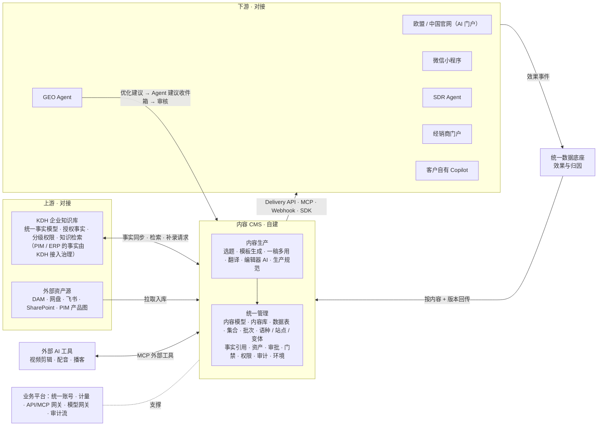

# 内容 CMS · 产品文档（v3，2026-11-19）

## 0. 一句话定位

**我们只做价值链里的“CMS 生产与统一管理”两环，其他环节都对接别的平台。**

名称说明：本文的“CMS”与原型、阶段文档里的“内容中台”指同一个产品。

```
知识源 → KDH 治理 → 【CMS 生产 → CMS 统一管理】 → 全渠道分发 → 效果回流
          对接              自建        自建            对接          对接
```

**自建**：内容怎么生产出来、怎么统一管住：

- 选题、生成、编辑、翻译、一稿多用；
- 模型、版本、语种、站点归属、变体、事实引用、资产；
- 审批、门禁、权限、审计。

**对接**：
- 事实从 KDH 来；
- 资产可以从外部库来；
- 内容交给门户、社媒、SDR、SEO/GEO 等平台去分发和展示；
- 效果数据由数据底座回传；
- 账号、计量、网关、模型、外部 AI 工具由平台提供。

**CMS 不渲染页面、不托管站点、不做访客个性化运行时、不做归因计算**，但会把这些平台需要的内容数据准备好，通过接口交出去：站点归属、hreflang、变体与实验标识、访问级别、令牌。

阅读说明：
- 细节见阶段文档：
  - `阶段一-框架范围与竞品.md`
  - `阶段二-信息架构.md`
  - `阶段二-整体架构.md`
  - `阶段二-内核技术方案.md`
  - `阶段三-原型评审.md`
- 原型在 `prototype/`，共 28 页，文中 `#/xxx` 是原型路由。
- 原型每页顶部有“位置条”：左边是面包屑（属于自建还是对接、在哪个菜单下），右边是当前页在主流程里的第几步。

状态标记：

| 标记 | 含义 |
|---|---|
| ✅ | CMS 侧已做，原型可演示 |
| ◐ | CMS 侧部分做到 |
| ❌ | 未做 |
| ➖ | 完全由对接平台负责，CMS 不需要界面 |

---

## 1. 结论

| 问题 | 结论 |
|---|---|
| 生产与统一管理是否完整 | **完整。** 选题 → 生产 → 编辑与检查 → 审核 → 发布，五步在原型里都有页面且互相连通。管理侧的模型、内容、数据表、集合、批次、语种、站点、变体、资产、事实引用、权限、审计、环境都有界面。 |
| 一条价值链是否“环环相扣” | **是。** 在我们的范围里，“环环相扣”指两端的对接合同清楚、原型可见：<br>• 上游 KDH：读取授权事实、录入回写、冲突回写、属性定义、可见级别 ✅<br>• 下游各平台：API / MCP / Webhook / SDK，以及按调用方、按站点授权 ✅<br>• 回流：效果数据进入选题，事实缺口向 KDH 发起补录 ✅ |
| 一份事实源是否成立 | **是。** 内容只引用授权事实 ✅；知识更新联动内容 ✅；模型、权限、审计一套机制 ✅（第 4.2 节，三处界面已补） |
| HubSpot 蓝本对照 | 共 42 项，其中 5 项完全由对接平台负责。CMS 负责的 37 项：✅ 35，◐ 2，❌ 0。<br>两项 ◐ 是“站点权限隔离”和“多域统一报表”：界面上已能按站点授权、按站点汇总，但更细的权限与报表依赖门户和数据底座。 |

---

## 2. 产品边界与架构

### 2.1 系统关系



### 2.2 对接清单

| 对接平台 | 方向 | 交换什么 | 方式 | CMS 页面 | 状态 |
|---|---|---|---|---|---|
| KDH 企业知识库 | 双向 | 读取授权事实；录入事实写入 KDH；冲突结果回写；属性定义与可见级别（只读）；检索片段；事实补录请求 | 事实同步 API、变更事件、检索 API / MCP | 事实库 `#/facts`、冲突处理、上游接入 `#/integrations`、选题 `#/production/topics` | ✅ |
| 外部资产源 | 拉取 | 资产文件、元数据、授权、源版本 | 连接器（默认导入副本，可选仅引用） | 资产 `#/assets`、上游接入 | ✅ |
| PIM / ERP | 经 KDH | 规格、交期等事实先进入 KDH 治理，CMS 只从 KDH 取；PIM 的产品图可直接拉取 | — | 上游接入（PIM 只拉图片） | ✅（按第 7 节建议调整，待确认） |
| AI 门户 / 站点 | 下发 | 已生效内容、数据表、站点归属与 hreflang、变体与实验标识、访问级别、令牌 | Delivery / Preview API、Webhook、SDK | 下游分发 `#/delivery`、组织与范围 → 站点、编辑器 | ✅ |
| SDR Agent / GEO Agent / 客户 Copilot | 下发 + 写回 | 只读取已生效、授权范围内的内容；GEO / SEO 通过写入级工具提交建议 | MCP 三级工具 | 下游分发 → MCP；审核 → Agent 建议 | ✅ |
| 统一数据底座 | 回传 | 按内容 + 版本、按变体的效果数据 | 效果回流 API | 效果回流 `#/insights/usage`、编辑器 → 变体、选题 | ✅ |
| 业务平台 | 支撑 | 统一账号、计量、网关、模型网关、审计流 | 平台接口 | 成员与角色、AI 与模型、审计日志 | ✅ |
| 外部 AI 工具 | 调用 | 视频剪辑、多语配音、播客；产出作为资产入库 | MCP 客户端 | AI 与模型 → 外部工具 | ✅ |

### 2.3 功能架构

```
┌────────────────────────── 内容 CMS（自建）──────────────────────────┐
│ 生产   选题 · 模板生成 · 一稿多用 · 翻译 · 编辑器 AI · 生产规范       │
│ 管理   内容模型 · 内容库 · 数据表 · 内容集合 · 发布批次               │
│        语种 / 站点 / 变体 · 事实引用（事实库、冲突处理）· 资产库      │
│ 治理   审批流程 · 发布检查 · 红线确认 · 范围权限 · 审计 · 健康度      │
│ 底座   组织与范围 · 成员与角色 · 规则 · 自动化流程 · AI 与模型 · 环境 │
├────────────────────────── 对接层（CMS 侧接口）─────────────────────┤
│ 上游接入（KDH、资产源）· 下游分发（API / MCP / Webhook / SDK）· 效果回流 │
└─────────────────────────────────────────────────────────────────────┘
```

### 2.4 组织结构

**① 产品菜单**：侧边栏分三区，共 28 页。

```
── 生产与管理 · 自建 ──
工作台
内容生产   选题 · 模板生成 · 一稿多用 · 翻译任务 · 生产规范（模板 / Brand Voice / 术语库）
内容管理   全部内容（编辑器：编辑 / 变体与个性化 / 语种版本 / 引用与依据 / 版本历史 / 调用情况）
           · 数据表 · 内容集合 · 发布批次
事实引用   事实库（含 KDH 属性定义）· 冲突处理
资产       资产库（含 AI 处理队列、从外部导入）
审核       我的待审 · 复核队列 · Agent 建议 · 审核记录
── 对接 · 其他平台 ──
对接       上游接入 · 下游分发（含 API 与 SDK）· 效果回流
── 运营与配置 ──
洞察       内容健康度 · 审计日志（含按事实追溯）
设置       内容模型 · 组织与范围（含站点）· 成员与角色 · 审批流程 · 规则 · 自动化流程 · AI 与模型 · 环境
```

**② 两条主流程**：顶部位置条会显示当前页在哪条流程的第几步。

```
内容主流程：  选题 → 生产 → 编辑与检查 → 审核 → 发布 →〔分发〕→〔效果回流〕→ 回到选题
事实变更流程：〔KDH 事实变更〕→ 事实库 → 冲突处理 → 影响内容复核 → 新版本发布
（〔〕内为对接环节）
```

**③ 客户组织（范围模型）**

```
集团 → 品牌 → 事业部 / 产品线
      × 区域
      × 语种
      × 站点 / 渠道
```

- 内容、事实、权限都挂在范围上。
- 范围与 KDH 共用同一套划分。

**④ 角色与权限**

- 有 6 个后台角色，按《信息架构》4.2 配置，原型中切换角色后菜单随之变化。
- 成员与角色页的矩阵和实际控制菜单的矩阵是同一份口径，已核对一致。
- 价格、交期、承诺类红线字段走人工审批。

**⑤ 团队**

| 团队 | 负责 |
|---|---|
| CMS 小组 | 本产品 |
| 数据中台组、知识中台组 | KDH 与数据底座 |
| 业务平台 | 账号、计量、网关、Agent 运行 |
| 门户、各 Agent 产品组 | 分发与展示 |

### 2.5 原型里的统一口径

原型的演示数据是一套完整的故事，各页面互相对得上：

| 维度 | 统一口径 |
|---|---|
| 品牌与产品 | 北岭智造：BL-R600 六轴工业机器人、BL-R800 新品、BL-R500 旧款、BL-D120 除尘设备；汉川传动：HC-RV200 减速机、HC-SD75 伺服驱动器 |
| 内容总量 | 237 条：草稿 18、审核中 5、已生效 214 |
| 内容类型（9 种 + 单例 + 3 张表） | 产品说明、技术 FAQ、客户案例、落地页、白皮书、销售资料、社媒短帖、公众号文章、销售话术卡；品牌信息（单例）；数据表：产品目录、伙伴名录、资源库 |
| 生成模板 | TPL-01～07，模板生成、一稿多用、生产规范三处一致 |
| 调用方 | 欧盟官网、中国官网（AI 门户）、微信小程序、GEO Agent、SDR Agent、Nordwerk 经销商门户、集团 Copilot；下游分发、效果回流、内容集合、发布批次四处一致 |
| 主线案例 | BL-R600 交付周期：07:35 KDH 改为 12 周 → 07:40 与中台的 8 周冲突（CF-021）→ 08:30 采纳 12 周 → 插槽刷新、生成复核 → 审核 → 发布批次 RB-030；审计日志可按 F-007 追溯全链路 |
| 待处理冲突 | 3 条：CF-018 防护等级、CF-022 扭矩、CF-016 UL 过期；CF-021 已处理 |

---

## 3. 一条价值链：我们负责的两环，以及两端的对接

| 环节 | 归属 | CMS 做什么 | 原型 | 状态 |
|---|---|---|---|---|
| ① 知识盘点 | KDH | 不参与 | — | ➖ |
| ② 知识治理 | KDH | 作为 KDH 的录入端和校验方：<br>• 读取授权事实、属性定义、可见级别；<br>• 中台录入的事实在确认前不可引用；<br>• 冲突结果回写 KDH；<br>• 向 KDH 发起事实补录 | `#/facts`、`#/facts/conflicts`、`#/integrations`、`#/production/topics` | ✅ |
| **③ 内容生产** | **CMS** | 选题（信号来自 KDH、回流、健康度）→ 模板与范围 → 只用可用事实 → 检索知识片段 → 生成 → 编辑器 AI → Brand Voice 检查；一稿多用、翻译；视频 / 配音 / 播客调用外部工具 | `#/production/*`、编辑器、`#/settings/ai` | ✅ |
| **④ 统一管理** | **CMS** | 模型、版本与事实快照、语种与 hreflang、站点归属、变体与实验、数据表、集合、批次、资产与授权、审批、门禁、红线、权限、审计、健康度、环境 | `#/content*`、`#/assets`、`#/review`、`#/settings/*`、`#/insights/*` | ✅ |
| ⑤ 全渠道分发 | 门户 / Agent | 按调用方、按站点授权下发已生效内容；Webhook；MCP 三级；SDK；越界返回 403 并留痕 | `#/delivery` | ✅ 对接侧 |
| ⑥ 效果回流 | 数据底座 | 接收效果（按内容、版本、变体）→ 健康度 → 选题；事实缺口 → KDH 补录 | `#/insights/usage` →「据此生成选题」→ `#/production/topics` | ✅ 对接侧 |

---

## 4. 一份事实源

### 4.1 内容只引用授权事实、知识更新联动内容

| 要求 | 做法 | 原型 | 状态 |
|---|---|---|---|
| 只引用 KDH 授权事实 | 正文数值用事实标签，参数表用事实插槽。<br>对外内容只能用：证据 A/B + 可见级别“公开” + 有效 + 无冲突。<br>不可用的事实在生成时灰显并写明原因。<br>正文手写的数值由 AI 抽取后与事实比对。 | 编辑器；`#/production/generate` 第 3 步；`#/settings/rules`；`#/facts/conflicts` CF-022 | ✅ |
| 中台录入的事实 | 中台是 KDH 的录入端，“待确认”期间不可引用 | `#/facts` 新建时的冲突预检；F-032“待确认” | ✅ |
| 知识更新联动内容 | 插槽引用自动刷新；正文引用生成复核任务；每个版本保存事实快照 | `#/settings/automations` FL-01；`#/review` 复核队列；编辑器“引用与依据” | ✅ |

### 4.2 两个系统在模型、权限、审计上一套机制

| 机制 | 做法 | 原型 | 状态 |
|---|---|---|---|
| 模型 | 属性、单位、区分维度、权威来源、红线标记都来自 KDH 统一事实模型；CMS 只读，内容模型的事实插槽直接绑定这些属性 | 事实库 → “属性定义（KDH）”；内容模型 → 事实插槽字段的说明 | ✅ |
| 权限 | 账号来自平台统一账号；范围与 KDH 共用；KDH 可见级别决定事实能否进入对外内容 | 事实库“可见级别”列；成员与角色页的说明；模板生成里“仅内部”灰显 | ✅ |
| 审计 | KDH 与 CMS 事件写入同一审计流，可从一条事实追到内容、审核、发布、调用 | 审计日志 → “按事实追溯”（F-007 全链路） | ✅ |
| 计量 | AI 用量与调用量写入平台计量 | AI 与模型 → 用量 | ✅ |

---

## 5. 蓝本对照：HubSpot Content Hub Enterprise

各列含义：
- **归属**：CMS 自建，还是对接某个平台。
- **CMS 做什么**：自建项是功能本身；对接项是 CMS 要提供的数据或接口。
- **状态**：只评价 CMS 侧。

### 5.1 ① 可扩展 CMS 与全球站点

| 能力 | HubSpot 做法 | 归属 | CMS 做什么 | 原型 | 状态 |
|---|---|---|---|---|---|
| 多站点 / 多根域名 | 一个账号管 10 个根域名 | 站点由门户承载 | 管理站点清单、内容所属站点、站点与语种页面的对应关系 | 组织与范围 → 站点；编辑器 → 语种版本 | ✅ |
| 站点权限隔离 | 按团队限制站点 | CMS + 门户 | 调用方按站点授权；成员范围可细到站点；门户侧编辑权限归门户 | 下游分发（站点范围）；成员与角色（Anna K.） | ◐ |
| 主题、模块跨站共享 | 主题与模块复用 | 主题归门户 | 内容组件跨类型、跨站复用 | 内容模型 → 组件 | ✅ |
| 多语言与 hreflang | 语言变体 + 自动 hreflang | CMS | 语种版本、翻译、术语库、回退语种；输出 hreflang | 编辑器 → 语种版本 → hreflang | ✅ |
| CDN / SSL / SLA | 托管 | 门户与平台 | — | — | ➖ |
| 反向代理 | 挂在客户现有域名下 | 门户 | — | — | ➖ |

### 5.2 ② 动态内容与结构化数据

| 能力 | HubSpot 做法 | 归属 | CMS 做什么 | 原型 | 状态 |
|---|---|---|---|---|---|
| 数据表与动态页面 | HubDB + 动态页面 | 表归 CMS，页面归门户 | 表格内编辑；绑定事实的列只读并自动刷新；通过 API 供门户生成页面 | `#/content/tables` | ✅ |
| 自定义对象驱动内容 | CRM 自定义对象 | CMS | 内容模型 + KDH 事实对象 | `#/settings/models` | ✅ |
| 批量导入与 API | 表格导入、HubDB API | CMS | 导入预检；Management API | 数据表导入、`#/delivery` → API 与 SDK | ✅ |
| 内容随数据自动同步 | 数据变更后页面更新 | CMS | 插槽自动刷新；正文引用生成复核 | 编辑器、`#/review` | ✅ |

### 5.3 ③ AI 内容生产

| 能力 | HubSpot 做法 | 归属 | CMS 做什么 | 原型 | 状态 |
|---|---|---|---|---|---|
| AI 写作 | AI 博客写作 | CMS | 选题后模板生成，只用授权事实，生成依据随版本保存 | `#/production/topics` → `#/production/generate` | ✅ |
| 内容助手 | 改写、翻译、调语气 | CMS | 编辑器 AI 面板；AI 段落逐段确认 | 编辑器 | ✅ |
| Brand Voice | 品牌语气 | CMS | 生成时套用，发布时检查 | `#/production/standards` | ✅ |
| Content Remix | 一稿多用 | CMS | 源内容须已生效，继承源事实 | `#/production/repurpose` | ✅ |
| AI 视频剪辑 / 字幕 / 配音 | 内置 | 字幕归 CMS，剪辑与配音对接外部工具 | 字幕、摘要、关键帧在资产 AI 中完成；剪辑、配音通过外部工具调用，产出入资产库 | `#/assets`、`#/settings/ai` → 外部工具 | ✅ |
| 播客工具 | 内置 | 对接外部工具 | 登记播客生成工具，音频入资产库 | `#/settings/ai` | ✅ |

### 5.4 ④ 内容治理

| 能力 | HubSpot 做法 | 归属 | CMS 做什么 | 原型 | 状态 |
|---|---|---|---|---|---|
| 多级审批 | 按内容类型 | CMS | 按范围 × 类型匹配审批链，可设条件与时限 | `#/settings/approvals`、`#/review` | ✅ |
| 分区管理 | Content Partitioning | CMS | 范围模型 | `#/settings/org` | ✅ |
| 层级团队权限 | 团队层级 | CMS | 组织层级 + 角色矩阵 + 红线字段 | `#/settings/members` | ✅ |
| 活动日志 | 活动记录 | CMS | 审计日志 + 按事实追溯 | `#/insights/audit` | ✅ |
| SSO | 企业 SSO | 平台 | 使用统一账号 | `#/settings/members` | ✅ |
| 发布门禁 | 发布前检查 | CMS | 证据、过期、冲突、可见级别、授权、禁用词、AI 未确认 | 编辑器 → 检查、`#/settings/rules` | ✅ |
| 代码警报 | 模板代码告警 | 门户 | — | — | ➖ |

### 5.5 ⑤ 体验与个性化

| 能力 | HubSpot 做法 | 归属 | CMS 做什么 | 原型 | 状态 |
|---|---|---|---|---|---|
| Smart Content | 按属性 / 地区 / 来源显示 | 内容归 CMS，运行时归门户 | 编辑变体与受众规则 | 编辑器 → 变体与个性化 | ✅ |
| 个性化令牌 | 插入访客属性 | 同上 | 令牌占位与回退文字 | 同上 | ✅ |
| 会员内容 | 登录可见 | 同上 | 访问级别（公开 / 会员 / 经销商） | 同上 | ✅ |
| A/B 与自适应测试 | 分流、选优 | 同上 | 变体带实验分组与流量比例，接收各变体效果 | 同上（EXP-12） | ✅ |

### 5.6 ⑥ 归因与分析

| 能力 | HubSpot 做法 | 归属 | CMS 做什么 | 原型 | 状态 |
|---|---|---|---|---|---|
| 内容归因到联系人 / 商机 / 收入 | CRM 原生 | 数据底座 | 接收按内容 + 版本的效果与线索数 | 效果回流 → 内容效果 | ✅ |
| 多域统一报表 | 跨域汇总 | 数据底座 | 按调用方 / 站点汇总调用与效果；细分报表在数据底座 | 效果回流 → 按调用方 / 站点 | ◐ |
| SEO 建议 | 页面建议 | SEO / GEO Agent | JSON-LD 与机器可读摘要；Agent 建议进入收件箱，采纳后生成草稿走审核 | `#/delivery` → 输出格式；`#/review` → Agent 建议 | ✅ |
| 视频与多渠道分析 | 内置 | 数据底座 | 按渠道的调用与效果 | 效果回流 | ✅ |

### 5.7 开发者能力

| 能力 | HubSpot 做法 | 归属 | CMS 做什么 | 原型 | 状态 |
|---|---|---|---|---|---|
| 开放 API 与 SDK | 内容、HubDB、站点 API | CMS | Delivery / Preview / Management API、MCP、Webhook、TS / Java SDK | `#/delivery` → API 与 SDK | ✅ |
| 模板语言与主题框架 | HubL | 门户 | — | — | ➖ |
| CLI / CI-CD | hs CLI | CMS（配置） | 开发 / 预发 / 生产之间对比和推送模型、规则、流程；导出给 CLI / CI | `#/settings/environments` | ✅ |
| Serverless Functions | 无服务器函数 | CMS + 平台 | 钩子 + 自动化流程；自定义代码通过 Webhook 动作调用外部函数 | `#/settings/automations` | ✅ |
| 自定义数据 / 对象 | 自定义对象、HubDB | CMS | 运行时建模 + 数据表 | `#/settings/models`、`#/content/tables` | ✅ |
| 企业级托管扩展 | CDN、代码警报、监控 | 门户与平台 | — | — | ➖ |

### 5.8 内容供应链

| 环节 | KA 要求 | CMS 做什么 | 原型 | 状态 |
|---|---|---|---|---|
| 选题 | AI 建议、负责人确认 | 汇总 KDH 缺口、买家问题、回流效果、健康度，生成建议；负责人采纳后带模板进入生产 | `#/production/topics` | ✅ |
| 生产 | 依据授权事实起草，统一口径 | 第 5.3 节全部 | `#/production/*` | ✅ |
| 审批 | 分区审批，红线人工放行 | 审批流程、红线确认、紧急放行、Agent 建议走审核 | `#/review` | ✅ |
| 发布 | 一次审核，多站点 / 多语种 / 多渠道分发 | 发布检查、批次、语种与站点、调用方授权 | `#/content/releases`、`#/delivery` | ✅ |
| 复盘 | 效果回流，反哺知识与选题 | 效果进入选题；事实缺口向 KDH 发起补录 | `#/insights/usage`、`#/production/topics` | ✅ |

### 5.9 合计

| 范围 | 项数 | ✅ | ◐ | ❌ | ➖ 对接平台负责 |
|---|---|---|---|---|---|
| 六组能力 | 31 | 26 | 2 | 0 | 3 |
| 开发者能力 | 6 | 4 | 0 | 0 | 2 |
| 内容供应链 | 5 | 5 | 0 | 0 | 0 |
| **合计** | **42** | **35** | **2** | **0** | **5** |

两项 ◐ 都跨在对接边界上：
- **站点权限隔离**：门户里谁能改哪个站点的页面，归门户。
- **多域统一报表**：细分维度的报表归数据底座。

CMS 侧已做到“按站点授权、按站点汇总”。

---

## 6. 按模块看竞品做法与我们的取舍

| 模块 | 竞品做法 | 我们 | 是否同样做 |
|---|---|---|---|
| 内容模型 | Contentful / Strapi / Payload：内容类型 + 组件；HubSpot：自定义对象 + HubDB | 运行时建模，含事实插槽、变体字段；保存前预览影响；在环境之间迁移 | 一致，多了事实插槽 |
| 事实引用 | HubSpot：知识库作 AI 上下文；Contentstack Knowledge Vault；Salsify：只暴露已批准属性 | 数值级引用 KDH 授权事实；快照随版本；变更联动复核；按事实追溯 | **更进一步，主要差异点** |
| 冲突处理 | 主数据管理的存活规则；HubSpot 与 Salesforce 按字段同步 | 五类冲突、排除假冲突、规则推荐、结果回写 KDH | 借鉴主数据管理 |
| 声明校验 | Aprimo Compliance Agent | 正文数值 AI 抽取后与事实比对 | 一致 |
| 选题 | HubSpot：AI 内容策略；Storyblok Agents：识别过期 / 缺失内容 | 四类信号（知识缺口、买家问题、回流、健康度）；缺事实时向 KDH 补录，不让 AI 编 | 一致，多了事实补录 |
| AI 生产 | HubSpot Remix / Brand Voice；Sitecore Brand Kit；Kontent.ai 准则复核 | 模板生成、一稿多用、Brand Voice 生成时套用 + 发布时检查、AI 段落逐段确认 | 一致 |
| 资产 | HubSpot 文件管理器；Contentful + Bynder 引用；Cloudinary 只返回已授权素材 | 自带资产库；默认导入副本；AI 理解；授权到期拦截 | 一致（不自建 DAM） |
| 治理 | HubSpot 审批 / 分区 / 活动日志；Contentstack 发布批次与环境 | 审批、范围、审计、门禁、批次、红线、环境 | 一致 |
| 多语言与站点 | HubSpot 语言变体 + hreflang + 多域名 | 语种版本、翻译、术语库、站点、hreflang 输出 | 一致；站点由门户承载 |
| 个性化 | HubSpot Smart Content / A/B；Sitecore 变体 + A/B/n | CMS 出变体、实验、令牌、访问级别；门户负责运行时 | 按边界一致 |
| 分发接口 | Contentful / Storyblok：Headless API + MCP（三级权限） | API、MCP 三级、Webhook、SDK、JSON-LD、越界 403 | 与 Headless 竞品一致 |
| 外部 Agent 写回 | Aprimo：外部 Agent 结果回灌受治理流程 | SEO / GEO / SDR 建议进收件箱，采纳后生成草稿走审核 | 一致 |
| 自动化 | HubSpot 工作流 / Serverless；Directus Flows；Payload Hooks | 自动化流程 + 钩子；外部函数用 Webhook | 一致 |
| 分析 | HubSpot 收入归因 | 接收回流、健康度、驱动选题；归因在数据底座 | 按边界一致 |
| GEO | Optimizely Q&A 字段；Progress JSON-LD | 机器可读摘要、FAQ 结构、JSON-LD | 一致 |

---

## 7. 需要决策的问题

1. **PIM、ERP 只经 KDH 进入**：原型已按这个建议调整，事实类只从 KDH 取，PIM 只拉产品图。需要知识中台组确认 KDH 接入 PIM / ERP 的排期。
2. **“一套机制”的接口口径**：
   - 属性定义与可见级别的只读接口；
   - 平台审计流的事件格式；
   - 统一账号与范围的同步方式。
3. **对接合同**：
   - 门户：站点、hreflang、变体、实验、令牌、访问级别的数据格式；
   - 数据底座：按变体回传效果的事件格式；
   - SEO / GEO Agent：建议提交格式。
4. **外部 AI 工具**：视频剪辑、配音、播客的首批供应商。
5. 沿用信息架构的待确认项：
   - 插槽自动刷新后，新版本免审还是简审；
   - 事实负责人是否独立设置。

---

## 8. 文档与原型的对应

- 本文所有 ✅ 项都标了原型路由。
- 原型 28 页都在第 2.4 节的菜单里。
- 侧边栏三个分区与第 2.3 节一致。
- 每页顶部位置条与第 2.4 节的两条主流程一致。
- 演示数据按第 2.5 节统一。
